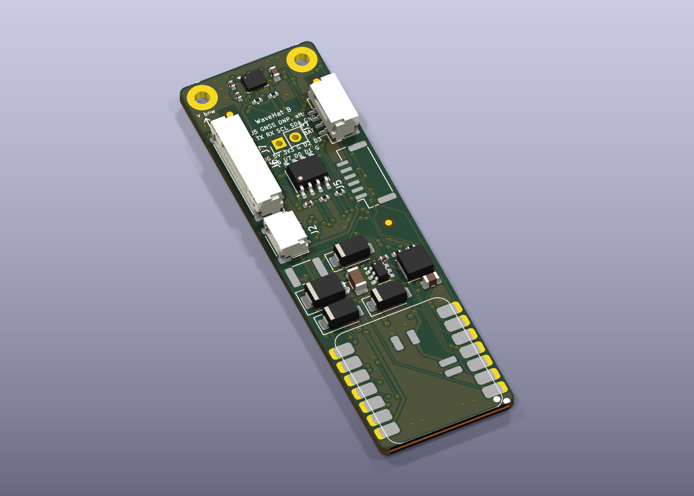

# WaveHat: a sea-state sensor for Signal K, on a Seeed XIAO

A small carrier board ("hat") for a **Seeed XIAO ESP32-C3, C6 or S3** with an ST **LSM6DSO** motion sensor, an **SN65HVD230** CAN transceiver and **256 MB of soldered log storage**. On a yacht it measures how the boat moves and turns that into **heave, significant wave height and wave period** for [Signal K](https://signalk.org), and listens on the NMEA 2000 backbone. The same board runs an eFoil's telemetry node under [VESC Express](https://github.com/vedderb/vesc_express).

## Why

Signal K knows the depth, the wind, the current and even a forecast wave height. It has no **measured** sea state. `environment.heave` is in the specification, and almost nothing fills it; there is no path at all for a measured wave height or period. A boat at anchor is a perfectly good wave buoy if you do the maths on its motion.

## What is here

| Path | What | Licence |
|---|---|---|
| [`hardware/kicad-revB/`](hardware/kicad-revB/) | **Rev B**, the current board (21 × 69 mm): KiCad 10 project, Gerbers, BOM, pick-and-place, JLCPCB and Seeed order packs, and the Python generator that builds all of it from one description | CERN-OHL-S 2.0 |
| [`hardware/kicad/`](hardware/kicad/) | Rev A (21 × 54 mm), the first boards built | CERN-OHL-S 2.0 |
| [`hardware/DESIGN.md`](hardware/DESIGN.md) | Requirements, layout, pin use for C3 / C6 / S3, power, CAN, manufacturing, and what rev A taught (§11) | |
| [`hardware/test-plate/`](hardware/test-plate/) | A printed jig and checklist for testing every via on a bare rev A board | CERN-OHL-S 2.0 |
| [`enclosure/`](enclosure/) | Printable gasketed enclosure: parametric OpenSCAD and STLs | CERN-OHL-S 2.0 |
| [`firmware/`](firmware/) | SensESP firmware (heave, Hs, Tp, Tz to Signal K; NMEA 2000 in, listen-only; on-board CSV log; GNSS port; battery mode), the wave maths in C++ and Python with its test harness and accuracy results, and VESC Express board files | MIT |
| [`signalk-plugin/`](signalk-plugin/) | `signalk-seastate`: a Signal K server plugin that makes a sea state from the heave a Precision-9 compass already puts on NMEA 2000 (PGN 127252). No WaveHat needed | MIT |
| [`REVIEW.md`](REVIEW.md) | A critical review of the plan and the maths against the objective (21 Oct 2026) | |

## What it sends

| Signal K path | Units | Spec status |
|---|---|---|
| `environment.heave` | m, up positive, 4 Hz | **Standard** |
| `environment.waves.significantHeight` | m, every ~79 s over the last ~20 min | Proposed; mirrors the Weather API's `waveSignificantHeight` |
| `environment.waves.period` | s, peak period Tp; null with no clear peak | Proposed; mirrors `wavePeriod` |
| `environment.waves.meanPeriod` | s, zero-crossing period Tz | Proposed |
| `environment.waves.underway` | bool: the window was taken with the boat moving | Proposed |

How: a Mahony filter finds "up", the acceleration is moved to the hull's roll/pitch centre (you enter where the box is mounted) and rotated to vertical, high-passed at 0.02 Hz and integrated twice to heave; a Welch spectrum over 0.04–0.5 Hz gives Hs = 4 √m0, Tp and Tz. Details and accuracy on synthetic seas (Hs within about 3 % RMS after calibration) are in [`firmware/README.md`](firmware/README.md).

## Status (9 Nov 2026)

Honest version: **no boat has been to sea with one yet.**

- **Rev A:** five boards built by JLCPCB in October 2026 and brought up on the bench. They had open vias from the fab's plating; rev B's layout changes (twinned vias, a test pad per layer crossing) come from that.
- **Rev B:** laid out, checked (ERC 0, DRC 0 errors) and ordered on 7 Nov 2026. Adds a GNSS port (J5), a 10-pin IO header (J6), jumpers that isolate the CAN transceiver (JP8–JP10) and a 1S battery option (J7). Not yet received.
- **Firmware:** builds for all three XIAOs; the wave maths is tested on the desktop and on a bare XIAO C3. The rev B features (GNSS, battery mode with wake-on-motion, bus heave logging) are written and build, and have not run on a board.
- **Signal K plugin:** maths tested against known seas; not yet run against a real compass.

## Limits

- It measures the **boat's** motion, not the water's. A hull filters short chop and can exaggerate swell near its own roll period: expect ±20–30 % on wave height at anchor until it is compared with a buoy.
- **Underway**, waves are met faster or slower than their true period, so periods mean something only at anchor or drifting. The `underway` flag says which.
- One sensor gives no reliable wave **direction**.
- A DIY NMEA 2000 node isn't certified. This one only listens: it never transmits, not even an acknowledge.

## Building one

- **Board:** the order packs in [`hardware/kicad-revB/fab/`](hardware/kicad-revB/fab/) go straight to JLCPCB (`ORDER.md` in each pack has the form settings). Choose electroless copper plating for the vias explicitly.
- **Regenerating the layout:** `hardware/kicad-revB/run_pipeline.sh` needs KiCad 10, Java and [Freerouting](https://github.com/freerouting/freerouting) 2.4.1; point the `FREEROUTING` environment variable at the jar.
- **Firmware:** [PlatformIO](https://platformio.org) with Python 3.10 or newer, then `pio run -e xiao_c3 -t upload` in `firmware/`.
- **Enclosure:** print the base and lid in ASA or PETG and the gasket in TPU; [`enclosure/README.md`](enclosure/README.md).

## Origin

The circuit comes from the telemetry node of a restored Takuma Cruiser V1 eFoil: a XIAO ESP32-C3 with an LSM6DSO and an SN65HVD230 on the ESC's CAN bus, running VESC Express in a sealed box (write-up: foil.zone thread 27157, "Bringing a Dead Takuma Cruiser V1 Back to Life"). WaveHat puts that on one factory-assembled board, keeps its pinout, and adds marine power input, NMEA 2000 and rigid mounting. Some documents here refer to that project's private notes by path; those notes are not in this repository.

## Licences

- Hardware (`hardware/`, `enclosure/`): [CERN-OHL-S 2.0](hardware/LICENSE).
- Software (`firmware/`, `signalk-plugin/`, the generator scripts): [MIT](LICENSE).
- The XIAO footprint in `hardware/kicad*/lib/seeed/` is from Seeed's OPL KiCad library, CC BY-SA 4.0.

## Sources

- ST LSM6DSO: datasheet DS12140, application note AN5192.
- Seeed XIAO pin maps: [ESP32-C3](https://wiki.seeedstudio.com/XIAO_ESP32C3_Getting_Started/), [ESP32-C6](https://wiki.seeedstudio.com/xiao_esp32c6_getting_started/), [ESP32-S3](https://wiki.seeedstudio.com/xiao_esp32s3_getting_started/).
- [VESC Express](https://github.com/vedderb/vesc_express), hardware target `hw_seeed_esp32c3`.
- [Signal K specification](https://github.com/SignalK/specification) and the server's Weather API.
- TI LMR51606 datasheet SLUSEY1B.
