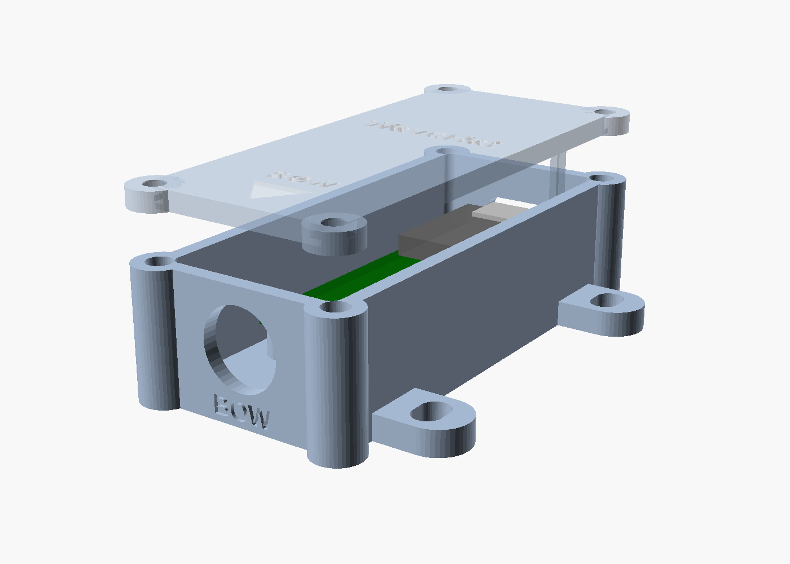

# WaveHat enclosure (3D-printable)

Many cruising yachts now carry a 3D printer for spares, so the enclosure is designed to be printed aboard from these files.



| File | Print in | Notes |
|---|---|---|
| `wavehat_base.stl` | ASA (PETG below decks) | Open side up, no supports |
| `wavehat_lid.stl` | ASA / PETG | Already flipped: flat top on the bed |
| `wavehat_gasket.stl` | TPU 95A | Or use 1.5–2 mm EPDM cord in the lid groove |
| `wavehat_usb_plug.stl` | TPU 95A | Press-fit plug for the USB-C opening, with a pull tab |
| `wavehat_enclosure.scad` | – | Parametric OpenSCAD source; every dimension is a named variable at the top |

**Print settings:** 0.2 mm layers, 5 or more perimeters, 40 % gyroid infill. Avoid PLA: it softens in a hot cabin and creeps under screw load.

**Hardware:** 2 × M2×5 screws and M2 heat-set inserts (board), 4 × M3×8 screws and M3 heat-set inserts (lid), 4 × M4 screws to the boat, 1 × PG7 cable gland (3–6.5 mm cable).

## Why it's shaped this way
- **Rigid mounting is the point.** The sensor measures the boat's motion, so any give between hull and board reads as waves. The base screws down through four slotted ears (the slots let you square it to the boat's centreline). Never use foam tape or Velcro.
- **Where:** near the boat's centre of motion, on or near the centreline, low and near midships, and bolted to structure. A box against the hull side reads the boat's rolling as heave. Then enter its position in the web UI. Details and numbers: `../firmware/README.md`, Mounting.
- **Leads solder underneath.** The NMEA 2000 pigtail or a 5–30 V supply lead solders to the J4 pads on the underside of the board; the standoffs leave 5 mm below it. Solder the lead before screwing the board down, and run it out through the gland.
- **The board is held at both ends.** It has mounting holes at one end only, so the far (USB) end rests on a rail in the base and the lid has two fingers that press it down. Put a dab of silicone or a TPU pad on each finger.
- **The bow end** carries the cable gland and "BOW" lettering; the lid has an arrow. Mount the box with that end forward and the board's silkscreen Y axis then points to the bow. The IMU's arrows are the chip's axes (checked on board 2, `../hardware/DESIGN.md` §5), so the firmware's axis map must take Y as forward and X as starboard; the Takuma eFoil script instead wants the board turned with X aft and Y starboard, which this box does not do.
- **No metal near the antenna.** The XIAO ESP32-C3 has no antenna on the board (found on the Takuma build), so stick its flexible U.FL antenna flat inside the lid. The C6 has a ceramic antenna as well.
- **Sealing:** gasket in the lid groove, the gland for the NMEA 2000 or supply lead (both solder to the J4 pads under the board), and the TPU plug in the USB-C opening. Open the lid, or pull the plug, to flash firmware. The Takuma approach of over-the-air updates means you rarely need to.

## Changing it
Open `wavehat_enclosure.scad` in OpenSCAD and edit the variables at the top (board size, wall, clearances, insert and screw sizes, gland hole). Export each part:

```bash
openscad -D 'part="base"' -o wavehat_base.stl wavehat_enclosure.scad
```

Repeat with `lid`, `gasket` and `usb_plug`; `assembly` shows everything together.

Dimensions follow `../hardware/DESIGN.md` (board 21 × 54 mm from the KiCad layout, M2 holes at 2.7 mm from the bow-end corners, XIAO USB-C at the stern end). **Check a test print against the real board** before printing the final set: the KiCad layout may move the holes slightly.
