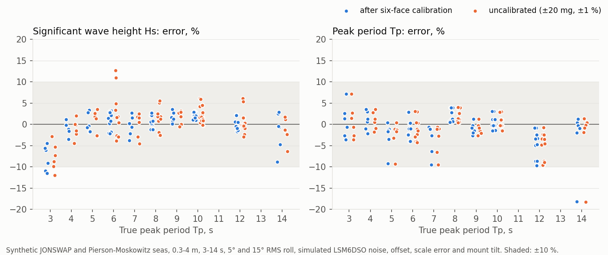

# WaveHat firmware and wave maths

Firmware for the WaveHat (XIAO ESP32-C3, C6 or S3 + LSM6DSO). It turns the boat's motion into **heave, significant wave height and wave period** and sends them to Signal K with [SensESP](https://github.com/SignalK/SensESP). It comes with a desktop harness that checks the same maths against synthetic seas. Each result is also written to the board's soldered 256 MB log storage.

**Or run VESC Express instead:** [`vesc_express/`](vesc_express/) has WaveHat board files for VESC Express (C3, C6, S3), with CAN on D0/D1 and the log storage on D8/D9/D10/D3 set up, so the board works as a CAN logger like Trampa's Express or the Nanolog.

**Status (17 Oct 2026):** the desktop tests pass, and the firmware builds for all three XIAOs. It has run on a **bare XIAO ESP32-C3** (no WaveHat, no IMU): it boots, SensESP comes up, it reports the missing IMU and keeps retrying, and the [compute times](#compute-cost) below are measured on that XIAO. **It has not run on a WaveHat** because the boards haven't been ordered, so everything about the LSM6DSO, the I²C reads and the log storage (added 20 Oct; the firmware builds with it) is still untested; see [Bring-up checklist](#bring-up-checklist).

## What it sends

| Signal K path | Units | When | Spec status |
|---|---|---|---|
| `environment.heave` | m, up positive | 4 Hz | Standard |
| `environment.waves.significantHeight` | m | every ~79 s, over the last ~20 min | Proposed (mirrors the Weather API's `waveSignificantHeight`) |
| `environment.waves.period` | s, peak period Tp | same; **null** when there is no clear wave peak (see step 6) | Proposed (mirrors `wavePeriod`) |
| `environment.waves.meanPeriod` | s, zero-crossing period Tz | same; null with Tp | Proposed |
| `environment.waves.underway` | bool | same | Proposed. True if the boat moved during the window: its mean SOG was above 1.5 kn, or SOG was above 1.5 kn for more than a quarter of it (a boat sheering at anchor, or a GPS jump, doesn't count). SOG from the boat's NMEA 2000 bus if the WaveHat is on one, else from a GNSS module on the rev B port, else `navigation.speedOverGround` from Signal K. Not sent if no SOG arrived |

The first height and period appear about 10 minutes after start-up (6 segments). The window reaches its full 20 minutes after about 21 minutes.

## How it works

Per IMU sample (LSM6DSO, 26 Hz, read from its FIFO every 250 ms):

0. **Mounting position:** the acceleration is moved from where the box is to the hull's roll/pitch centre, `a = f − α×r − ω×(ω×r)`, with r the mounting position entered in the web UI (see [Mounting](#mounting)) and α a central difference of the gyro. This delays everything by one sample (38 ms). Without it, a box away from the centre reads its own up-and-down motion from rolling and pitching as heave.
1. **Attitude:** a 6-axis Mahony filter (accelerometer and gyro, no magnetometer) with gyro-bias estimation. Its correction gain gives a ~20 s time constant, so wave accelerations barely tilt the estimate. The filter starts from whatever "up" it measures, so the box's mounting yaw, or even upside down, doesn't matter for height and period.
2. **Vertical acceleration:** the specific force is rotated into the earth frame, and g is removed.
3. **Heave:** a 4th-order Butterworth high-pass at 0.02 Hz folded into a double integrator, `HP4(s)/s²`, as two biquads in double precision. Offsets and drift cannot integrate up.
4. **Spectrum:** an anti-alias low-pass at 1.2 Hz, then decimation by 8 to 3.25 Hz. The wave band stops at 0.5 Hz, so the FFT needs only 512 points instead of 4096 at 26 Hz, with the same 0.0063 Hz resolution. The spectrum is a Welch average: 157.5 s segments, 50 % overlap, Hann window, mean removed.
5. **Statistics:** the displacement spectrum is `S_a(f) / (2πf)⁴` on 0.044–0.495 Hz (FFT bins 7–78 at 0.0063 Hz; the 0.04–0.5 Hz in the code is rounded inward to whole bins, so the longest period it can see is 22.5 s), averaged over the last 14 segments (≈20 min). From it come **Hs = 4√m0**, **Tz = √(m0/m2)** and **Tp** = the peak of a 3-bin-smoothed spectrum, interpolated between bins. RMS heave is reported as √m0 and as the RMS of the heave output.
6. **Quality gate:** Tp and Tz are sent as null when Hs is under 5 cm (flat calm: the spectrum is sensor noise, which reads 22 s and 10–15 s), when the smoothed peak sits on the first or last bin (the sea's peak is outside the band, e.g. swell longer than 22.5 s), or when the peak is less than twice the band's median (no clear peak; broad 3 s chop, cut off at 0.5 Hz, still has 2.9). Hs is always sent. The log keeps Tp and Tz with a `periods_valid` column.

The C++ in [`lib/wavemath/`](lib/wavemath/) is a line-for-line port of [`desktop/wavemath.py`](desktop/wavemath.py). The tests build it natively and check it against the Python to within 0.2 %.

## Accuracy on synthetic seas

[`desktop/evaluate.py`](desktop/evaluate.py) simulates 93 sea states per variant, each 25 minutes long:
- JONSWAP (γ = 3.3) and Pierson-Moskowitz spectra, Hs 0.3–4 m, Tp 3–14 s, three random seeds each;
- 5° RMS roll with a 5 s roll resonance, or 15° for the rolly cases;
- slow yaw around the anchor, orbital surge/sway, and the box mounted 3° off level;
- LSM6DSO errors: datasheet noise densities (75 µg/√Hz at ±4 g, 3.8 mdps/√Hz); zero-g and zero-rate offsets up to ±20 mg / ±1 dps and a ±1 % per-axis accelerometer scale error, which are typical values for this sensor family and have not been checked against DS12140; and quantisation.



| Over all 93 runs | Hs error | Tp error | Tz error ¹ | Heave RMS error |
|---|---|---|---|---|
| **After six-face calibration** (±2 mg, ±0.2 % left) | bias 0.0 %, RMS 3.1 %, worst −11 % ² | bias −1 %, RMS 3.8 %, worst −18 % ³ | within ±4 % | within ±4 % |
| Uncalibrated (±20 mg, ±1 %) | bias +0.4 %, RMS 3.8 %, worst +13 % ⁴ | the same | within ±5 % | up to +77 % with 15° roll ⁴ |
| No tilt correction (body Z taken as vertical) | +86 % average, up to +590 % | +180 % average | | |

Flat calm (sensor noise and offsets only) reads Hs ≤ 0.6 cm.

¹ Tz is compared with the 0.04–0.5 Hz part of the true spectrum. Against the whole spectrum, Tz reads high in short seas because the band stops at 0.5 Hz.
² 0.3 m chop at 3 s: the 0.5 Hz upper band edge cuts off part of the wave energy (−8 % on average). Everywhere else Hs is within ±4 % on average and ±9 % in the worst run.
³ Tp is the noisiest number. Broad Pierson-Moskowitz spectra have a flat top, and 20 minutes of data cannot place the peak more precisely than about ±10 %, or −18 % once for a 14 s swell.
⁴ An accelerometer offset or a scale mismatch between axes does nothing on a level boat. When the boat rolls hard, it becomes false vertical acceleration at wave-group frequencies, which the double integration amplifies. That is why the firmware has a [calibration](#calibration).

Per-sea-state numbers are in [`desktop/results/summary.md`](desktop/results/summary.md), and every run is in `results.csv`.

**What this does *not* test:** the hull. The simulated boat follows the water surface exactly, so these numbers measure the **maths and the sensor**, not the sea. A real hull filters short chop and can exaggerate swell near its own roll period. Expect about ±20–30 % on Hs at anchor until you have compared it with a buoy or a forecast. Underway, waves are met at the encounter frequency, so periods are distorted; that is what `underway` flags. One IMU gives no reliable wave direction, so the firmware sends none.

## Desktop harness

Python 3.9+ with numpy (matplotlib for the chart):

```bash
cd desktop && python3 -m unittest -v test_wavemath
```

```bash
cd desktop && python3 evaluate.py
```

The tests take ~30 s and also build `lib/wavemath` with the host C++ compiler and compare it with Python. `evaluate.py` runs the full matrix (~4 min on 8 cores) and rewrites `results/`.

| File | What |
|---|---|
| `desktop/wavemath.py` | The algorithm, sample by sample, as the firmware runs it |
| `desktop/seasim.py` | Synthetic seas and the simulated LSM6DSO |
| `desktop/test_wavemath.py` | Unit tests: filters, attitude, spectrum, sea states, C++ against Python |
| `desktop/evaluate.py` | The accuracy matrix, the chart and `results/summary.md` |
| `desktop/native/main.cpp` | Runs `lib/wavemath` on a recorded or simulated IMU file (`float32` rows `gx gy gz ax ay az`) |
| `desktop/lever_arm.py` | Hs error with the IMU away from the roll/pitch centre, with and without the mounting position entered; results in `results/lever_arm.md` |
| `desktop/test_native_libs.py`, `desktop/native/n2k_test.cpp`, `underway_test.cpp` | Builds `lib/n2k` and `lib/underway` natively: NMEA 2000 frames (every PGN, "not available" values, magnetic heading with variation, two GPS sources), and SOG patterns for the underway flag (a GPS jump, sheering, motoring, arriving at anchor) |

The firmware's small libraries have their own tests (a second, no numpy needed):

```bash
cd desktop && python3 -m unittest -v test_native_libs
```

## Firmware

| | |
|---|---|
| Framework | SensESP **3.6.0** (latest release, 17 Sep 2026), on Arduino-ESP32 3.3.12 / ESP-IDF 5.5.5 through the pioarduino platform `55.03.312-1`. pioarduino is SensESP's recommended platform and the only PlatformIO platform that supports the C6 |
| IMU | LSM6DSO on I²C D4 (SDA) / D5 (SCL), 400 kHz, address 0x6B. 26 Hz accel + gyro, ±4 g / ±500 dps, high-performance mode, batched in the FIFO (continuous mode) and read every 250 ms. Driver in `lib/lsm6dso/`, with registers checked against ST's `lsm6dso-pid` |
| Sample rate | Measured against the ESP32 clock every 2 minutes. If the LSM6DSO's oscillator is more than 0.5 % off 26 Hz, the analysis restarts at the real rate |
| Log storage | SD NAND (256 MB, soldered under the XIAO) in SPI mode on D8 (SCK), D9 (MISO), D10 (MOSI), D3 (CS); mounted with Arduino's SD library and formatted on first use. One CSV line per result in `/waves.csv` (uptime, UTC once NTP has set the clock, Hs, Tp, Tz, heave RMS, segments, sample rate, underway, then the boat's values from NMEA 2000: lat, lon, SOG, COG, heading, speed through water, depth, true wind speed, each empty when unknown, and last the bus's own heave statistics; a log written before those columns existed is set aside as `/waves-old-N.csv` at boot). A line is about 130 bytes, so about 50 MB a year: the 256 MB lasts about five years. Its state is on the status page ("Log storage"). Code in `src/wave_log.h` |
| NMEA 2000 in | The ESP32's CAN controller (TWAI) on D0 (RX) / D1 (TX) at 250 kbit/s, in **listen-only** mode: it never transmits, not even an acknowledge, so it can't disturb the boat's bus, and it needs no NMEA 2000 address. A task of its own decodes the frames (`lib/n2k`, `src/n2k_bus.h`). Decoded: 129026 SOG/COG, 129025 position, 127250 heading, 128259 speed through water, 128267 depth, 130306 true wind, and 127252 heave (a B&G/Simrad Precision-9 compass sends it at 10 Hz). The bus heave is not used in the wave maths: its mean and RMS over each ~79 s hop go into the log beside the WaveHat's own (`bus_heave_rms_m`, `bus_heave_mean_m`, `bus_heave_n`), so the two can be compared on the same hull; the hops of a window combine as √(mean of rms²), to set against `heave_rms_td_m`. SOG feeds `underway` (preferred over Signal K's); all of them go into the log. Each PGN follows one source, so two GPSs on the bus don't alternate. Adding a value is a row in the table in `lib/n2k/src/n2k.cpp`; fast-packet PGNs (129029 GNSS data, for example) are not reassembled yet. The status page's "NMEA 2000" line counts frames and shows the latest SOG, position and heading |
| GNSS port (rev B) | A module on J5 (or on J6 pins 6/7) talking NMEA 0183 on the XIAO's UART: D7 RX, D6 TX (nothing is sent). RMC and GGA from any talker, checksummed. Gives SOG, COG and position when the NMEA 2000 bus has none, and sets the clock from RMC when NTP has not, so the log's UTC column is filled with no Wi-Fi. Off by default: Configuration → **GNSS port** (enabled, baud; u-blox default 9600), takes effect at the next restart. A Pixhawk-style module's compass is only detected on the I²C bus (0x0C, 0x0D, 0x1E, 0x30) and named on the status page, not read. Code in `src/gnss.h`. **Not yet run with a module** |
| Battery mode (rev B) | Configuration → **Power**. For a WaveHat on a 1S cell (J7) with no bus: the CAN controller is left off (cut JP8–JP10 too, so the unpowered transceiver is off D0/D1), and after the board has been still for the set minutes (|a| spread under 30 mg and gyro under 1 °/s in every 250 ms poll) it arms the LSM6DSO's wake-on-motion (12.5 Hz low-power accel, about 62 mg threshold, INT1) and deep-sleeps until INT1 rises on D2 (**JP4 must be bridged**) or a fallback timer (default 6 h) fires. A wake is a reboot; the status page's "Power" line says which. 0 still minutes = never sleep (the default). Code in `src/power_mode.h`, `lib/lsm6dso` (`enable_wake_on_motion`), `main.cpp`. **Not yet run on a board**, and the sleep current is unmeasured |
| Mounting orientation | Configuration → **Mounting orientation**: which way the silkscreen "Y bow" arrow points (forward/aft/port/starboard) and whether the parts face up or down. Maps the chip's axes to the body frame (X starboard, Y bow, Z up) after the calibration and before the wave maths; a change restarts the analysis. The yacht enclosure's mounting (bow arrow forward, component side up) is the default and changes nothing. Code in `src/orientation.h` |
| IO header J6 (rev B) | Carries D2, D3, D6, D7, D0, D1 plus 5 V, 3V3 and two grounds (`src/board.h` has the table). This firmware drives D6/D7 only when the GNSS port is enabled, D3 as the NAND chip select, D0/D1 as CAN unless in battery mode, and reads D2 only as the sleep wake pin. D0/D1 are free for a lead only with JP8–JP10 cut and battery mode on |
| Pins by variant | `src/board.h`: the XIAO pin names are the same on all three; the GPIO numbers behind them differ (D2 is GPIO 4 on the C3, 2 on the C6, 3 on the S3, all deep-sleep wake pins) |

Build all three, or flash one:

```bash
pio run
```

```bash
pio run -e xiao_c3 -t upload -t monitor
```

The build needs PlatformIO Core with **Python 3.10 or newer**: pioarduino refuses the macOS system Python 3.9.

| Environment | Board | Flash (of 1.9 MB app slot) | Static RAM | BOOT button |
|---|---|---|---|---|
| `xiao_c3` | Seeed XIAO ESP32-C3 | 92 % | 45 KB | GPIO 9 |
| `xiao_c6` | Seeed XIAO ESP32-C6 | 94 % | 52 KB | GPIO 9 |
| `xiao_s3` | Seeed XIAO ESP32-S3 | 86 % | 56 KB | GPIO 0 |
| `xiao_c3_n2k_selftest` | XIAO C3, bench only | 89 % | 45 KB | GPIO 9 |
| `xiao_c3_sim_imu` | XIAO C3, bench only | 89 % | 45 KB | GPIO 9 |

All builds set `SENSESP_SK_WS_BUFFER_SIZE=4096`: the first delta after connecting carries the metadata (units, descriptions) of all five paths, about 1.9 kB, and SensESP's default 1024-byte buffer drops it.

`xiao_c3_n2k_selftest` checks the NMEA 2000 listener on a bare XIAO, with no transceiver or bus: the CAN controller loops back inside the chip (TX and RX on D1, no-ack mode) and sends itself made-up frames, SOG ramping 0–11.7 kn, a position, a heading and a depth. The minute log line then reads, for example, `NMEA 2000: 964 frames, 964 used, 0 missed; SOG 9.33 kn from 66; -33.85680, 151.21530; heading 57 T`. **This build transmits: never put it on a real bus.**

### Simulated IMU

`xiao_c3_sim_imu` runs everything after the IMU on a bare XIAO, at 8 times real time: a level board heaving 0.50 m at 8.0 s (so **Hs 1.41 m, Tp = Tz = 8.0 s**) goes through the real wave maths, the Signal K outputs, the log and, on the boat computer, the bridge and the radar. SOG follows a script in sea time: anchored at 0.2 kn until 25 min, motoring at 5 kn from 25 to 45 min, anchored again. The status page's IMU line says SIMULATED. Expected:

- the first result about 70 s after boot (9.2 sea-minutes), then one every ~10 s;
- Hs 1.41 m ±3 %, Tp and Tz 8.0 s ±0.3 s, `periods_valid` 1;
- `underway` false, then true from about 30 sea-minutes (once a quarter of the window is moving), then false again about 12 hops (16 sea-minutes) after 45 min, once less than a quarter of the window was moving.

**Not for a boat**: it ignores the IMU.

**Result on a bare XIAO C3, 21 Oct 2026** (54 results over 10 minutes, 72 sea-minutes): Hs 1.42 m, Tp 8.1 s, Tz 8.0 s in every result, the first 72 s after boot. `underway` stayed false while anchored, went true at the 4th motoring hop (26 % of the window above 1.5 kn), and false again 12 hops after the motoring stopped (22 %); the mean SOG and the share above 1.5 kn are in each log line. No Signal K server was reachable, so the server, bridge and radar hops are still to do.

The partition table has two app slots, so later updates can go over the air and the box can stay sealed. SensESP's factory-reset button would default to GPIO 0, which on the C6 is D0, the CAN RX line, so each build points it at that XIAO's BOOT button instead.

**First start:** SensESP opens a Wi-Fi access point called `wavehat`, with SensESP's default password `thisisfine` (change it in the web UI). Join it, set the boat's Wi-Fi, and approve the device's access request in the Signal K server's admin UI. The status page has a WaveHat group: sea state, IMU state and real sample rate, compute time, and the raw accelerometer mean.

### Mounting

Where the box goes matters as much as the maths. When the boat rolls and pitches, a point away from the hull's roll/pitch centre moves up and down, and the IMU reads that as heave. On the simulator, a box **1 m off the centreline** reads Hs **+10 %** high in a 2 m / 8 s sea, **+27 %** in a 1 m / 6 s sea and **+87 %** with 15° of roll; 0.3 m off gives +3 to +24 % (`desktop/results/lever_arm.md`). Tp is barely affected. So:

1. **Mount it near the centre of motion:** on or near the centreline (within 0.3 m), low in the boat, and near midships (the pitch centre is close to the centre of the waterplane, usually at or a little aft of midships). The keel-stepped mast support, the bilge near the keel bolts, or the saloon sole on the centreline are good places; a nav station or quarter berth against the hull side is not.
2. **Bolt it to structure**, bow end forward, square to the centreline (the base's slotted ears are for squaring it). If it cannot go that way round, set Configuration → **Mounting orientation** to where the silkscreen bow arrow actually points and whether the parts face up or down.
3. **Measure where it is** from that centre, in metres: x to starboard (port negative), y forward (aft negative), z above the waterline. Enter them under Configuration → **Mounting position** and save; the analysis restarts. The wave maths then takes the rolling and pitching out (on the simulator, back to within 1 % of the centre's reading). An entry 20 % short leaves about 20 % of the effect, so a tape measure is enough; it doesn't have to be exact.
4. Note the position and the date in your own records: a later re-mount needs new numbers.

### Calibration

Do this once, before closing the box (or with the box closed, on a flat surface):

1. Open the device's web UI → Status, and read the **Raw accel** line (a 10 s mean in g).
2. Rest the box still on each of its six faces in turn. For each axis, note the reading with that axis pointing up (≈ +1) and pointing down (≈ −1).
3. For each axis: **offset = (up + down) / 2** and **scale = 2 / (up − down)**.
4. Enter the six numbers under Configuration → Accelerometer calibration, and save.

The gyro needs no calibration: the attitude filter tracks its bias.

### Compute cost

The C3 and C6 have no FPU, so every float operation is a software call. The firmware benchmarks itself 5 s after boot, logs the result every minute, and shows it on the status page ("Compute"). **Measured on a XIAO ESP32-C3 (160 MHz), 17 Oct 2026:**

| Work | C3, measured |
|---|---|
| Per IMU sample: Mahony, 4 double-precision biquads, decimation | **145 µs**, × 26/s = **0.4 % CPU**; **168 µs** (0.44 %) with the mounting-position correction (21 Oct 2026) |
| One Welch segment (every 79 s): 512-point FFT, window, spectrum, statistics | **18.9 ms** |
| The 512-point FFT alone | 16.3 ms |
| A 4096-point FFT, as the full 26 Hz stream would need (for comparison) | 178 ms |
| Free heap with SensESP and Wi-Fi running | 107 KB; 86 KB with the NMEA 2000 listener and the log storage code (21 Oct 2026) |

Decimating to 3.25 Hz before the FFT makes the spectrum about ten times cheaper. Even without it, the C3 would have managed. The C6 has no FPU either and should be similar. The S3 has a single-precision FPU and should be faster; it hasn't been measured yet. On an Apple M1 the same C++ takes 6 µs per segment.

## Exodus radar bridge

[`bridge/swell_bridge.py`](bridge/swell_bridge.py) runs on the boat computer. Every minute it reads the WaveHat's paths from Signal K and writes `~/.swell.json` for the Exodus radar's swell display (format in `reference/sailing-exodus/01-radar/source/README.md`):

```json
{"t": 1792243200, "hs_ft": 3.9, "period_s": 8.0}
```

It writes no `from_true_deg`, because one IMU can't give a reliable direction. The radar then shows height and period without direction bars. `t` is when the WaveHat measured the values, so the radar's 10-minute limit counts from the measurement. It skips writing, and the radar stops drawing swell 10 minutes later, when:

- the data is more than 10 minutes old (the WaveHat stopped or lost Wi-Fi);
- the boat was underway, **or the WaveHat doesn't know** (`underway` missing, or older than the result: no SOG reached it). `--assume-anchored` writes anyway, for a boat with no SOG source at all;
- there is no wave period (flat calm, or no clear peak: the WaveHat sends null).

Standard library only:

```bash
python3 bridge/swell_bridge.py --once --verbose
```

Set `SIGNALK_URL` if the server isn't on `http://localhost:3000`. Signal K servers with security on refuse unauthenticated reads (HTTP 401, which the bridge reports as such): set `SIGNALK_TOKEN` to a **device** token (a user's login token expires), or allow read-only access in the server's security settings. The Exodus radar reads `/home/pi/.swell.json`; the bridge writes `~/.swell.json`, which is the same file when it runs as `pi` (otherwise pass `--out /home/pi/.swell.json`). To keep it running, a user systemd unit (run `loginctl enable-linger` once so it starts at boot, not at login):

```ini
# ~/.config/systemd/user/swell-bridge.service
[Unit]
Description=WaveHat to Exodus radar swell bridge
[Service]
ExecStart=/usr/bin/python3 %h/path/to/firmware/bridge/swell_bridge.py
Restart=always
[Install]
WantedBy=default.target
```

Its tests: `cd bridge && python3 -m unittest -v test_swell_bridge`.

## Bring-up checklist

**Read [`../REVIEW.md`](../REVIEW.md) first** (21 Oct 2026): it adds a mounting rule, a known-stroke test, a still-bench noise test, a vibration sweep and a sea-trial pass/fail, and changes the order of the first unit's bring-up.

Everything but the compute time needs a WaveHat board:

- [ ] `WHO_AM_I` reads 0x6C at 0x6B (JP3 default). The status page says "LSM6DSO running".
- [ ] FIFO reads: the driver reads the tag byte, then six data bytes, as ST's driver does. The logged rate should be close to 26 Hz, with no "FIFO overrun" warnings.
- [ ] Axes and signs: lying flat, component side up, Raw accel reads about `z +1.00`; tilting the bow (silkscreen +Y) down makes y negative.
- [x] Compute time on a C3 (done on a bare XIAO, see above). Still to do on a C6 and an S3.
- [x] NMEA 2000 decoding on the chip: `xiao_c3_n2k_selftest` on a bare XIAO C3, 21 Oct 2026 (964 of 964 frames decoded, values as sent).
- [ ] NMEA 2000 on a real bus: J4 to the backbone, termination JP6 open. The "NMEA 2000" status line counts frames and shows the boat's SOG and position, and `underway` follows the boat's speed. Check with the chartplotter that nothing on the bus complains (the WaveHat shouldn't appear in its device list: it never transmits).
- [x] Wave maths, period gate and underway flag on the chip, without an IMU: `xiao_c3_sim_imu` on a bare XIAO C3, 21 Oct 2026 (see [Simulated IMU](#simulated-imu)).
- [ ] The rest of the chain with the same build: the values and their units in the Signal K server's Data Browser, the bridge writing `~/.swell.json` (hs_ft 4.6, period_s 8.1), the radar showing "SWELL 4.6 ft 8 s" with the anchor watch on, and nothing drawn while `underway` is true. Needs a Signal K server the XIAO can reach.
- [ ] The calibration values are sensible: offsets within ±0.03 g, scales within 0.98–1.02.
- [ ] Mounted as in [Mounting](#mounting), and its position entered: the boot log line "wave processor at 26.000 Hz, IMU at x … y … z … m" shows it.
- [ ] Log storage: the status page shows close to 250 MB after the first boot formats it, and `/waves.csv` gains a line per result. The XIAO still boots and enters the bootloader with BOOT held (the storage's pull-ups on D8/D9).
- [ ] On the bench, rocking the box by hand moves `environment.heave`; a slow constant tilt does not.
- [ ] At anchor, compare Hs and Tp with a nearby buoy or the forecast for a few days, and note the hull's factor (REVIEW.md §6 has the pass/fail).

Rev B additions (7 Nov 2026; the code builds for all three XIAOs but none of it has met a board):

- [ ] Mounting orientation: set "bow arrow aft" on the bench and check Raw accel is unchanged (chip frame) while tilting the bow down now makes the body-frame pitch the other way (the attitude log line, or a heave sign check with a known stroke).
- [ ] GNSS port: a u-blox module on J5 (or a lead on J6 pins 6/7), GNSS port enabled at 9600. The "GNSS" status line counts sentences, then shows a fix; with Wi-Fi off, the log's UTC column fills from RMC. Confirm the module's TX is on D7 (RX) and not swapped.
- [ ] Battery mode on the bench XIAO C3 (the free test board; **never the Takuma XIAO**): JP4 bridged, Power → battery, sleep after 2 min. Still on the bench it logs "sleeping"; a tap wakes it and the boot log says "woken by motion". With JP4 open it must still wake on the timer. Measure the sleep current across the cell lead.
- [ ] A no-CAN build (JP8–JP10 cut) in battery mode shows "NMEA 2000: off (battery mode)" and no TWAI errors in the log.

### Test boards

One more rev A board is left to assemble (the other two were the 29 Oct bring-up boards): it is the bench and first-sea-trial unit for this firmware until the rev B boards arrive (ordered 7 Nov 2026). Rev A has no J5, J6 or J7, so the rev B features that can be tried on it are the orientation map (pure firmware) and battery mode with a cell wired to the XIAO's own BAT pads; the GNSS port needs wires to D6/D7.

Candidate second boat: **Delos 2.0** (SV Delos's new build) runs Signal K, and the crew are technical, so a WaveHat there would be a real second data set against a different hull. What it would need from them: 12 V (J4 or USB-C), Wi-Fi to their Signal K server, a mounting spot near the roll/pitch centre with the position measured, and the web UI's Mounting position entered. Nothing has been proposed to them yet.

## Sources

- SensESP 3.6.0 source and examples: https://github.com/SignalK/SensESP (tag `v3.6.0`); pioarduino platform: https://github.com/pioarduino/platform-espressif32 (release `55.03.312-1`).
- ST LSM6DSO datasheet DS12140 (noise densities) and ST's register driver https://github.com/STMicroelectronics/lsm6dso-pid (`lsm6dso_reg.h`: addresses, bit fields, FIFO tags).
- Spectral wave statistics (Hs = 4√m0, Tz = √(m0/m2)) and the JONSWAP / Pierson-Moskowitz spectra: standard ocean-wave practice, e.g. Holthuijsen, *Waves in Oceanic and Coastal Waters* (2007).
- Mahony, Hamel, Pflimlin, "Nonlinear complementary filters on the special orthogonal group", IEEE TAC 2008. Biquad designs from R. Bristow-Johnson's Audio EQ Cookbook.
- Signal K: `reference/signal-k/` (`environment.heave` in the specification; `waveSignificantHeight` and `wavePeriod` in the Weather API).
