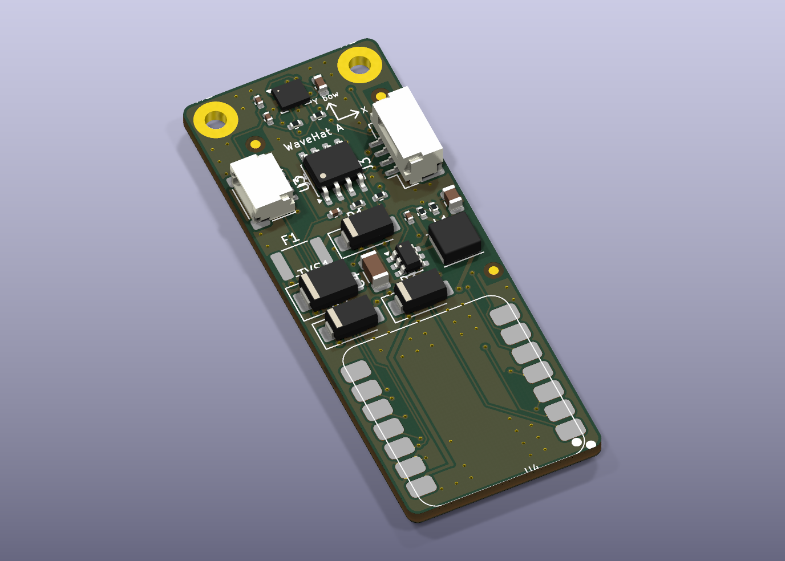
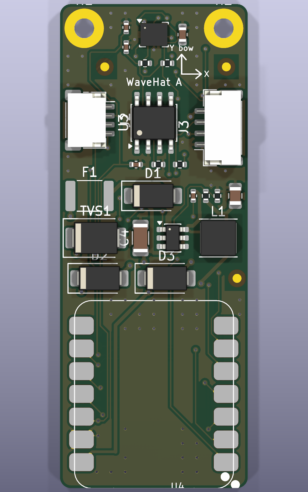
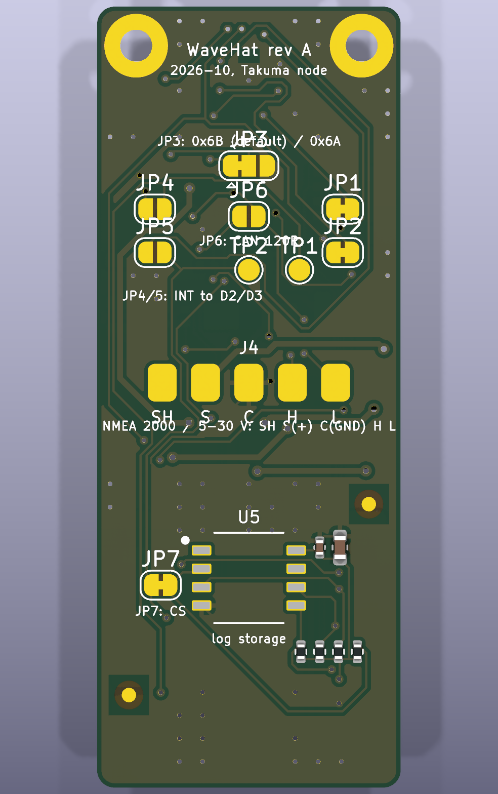
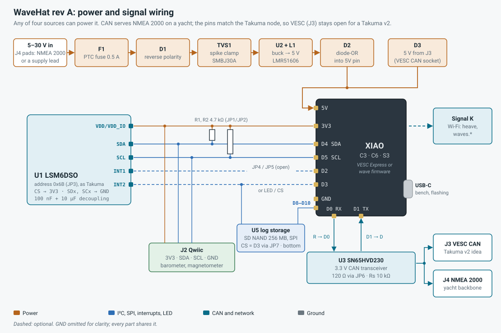

# WaveHat hardware design (rev A, draft)

## 0. Origin: the Takuma box node
WaveHat is the boat version of a board already running on the bench in **the Takuma project**: the restoration of a Takuma Cruiser V1 eFoil, documented in the private `efoil` workspace (`designs/ranges/takuma/wiring.md` §3, `xiao_wiring.py`, `xiao_can/`, `firmware/xiao/`) and in the foil.zone thread 27157, "Bringing a Dead Takuma Cruiser V1 Back to Life", updates 5 and 6.

That node is a **Seeed XIAO ESP32-C3 with an LSM6DSO on its I²C and an SN65HVD230 CAN transceiver**, running Vedder's VESC Express firmware in a sealed box. The WaveHat takes what it proved and puts it on one assembled board:

| Proven on the Takuma node (Oct 2026) | Carried into WaveHat |
|---|---|
| XIAO ESP32-C3 + LSM6DSO on D4 / D5 | Same pins. |
| LSM6DSO at address **0x6B** (SA0 high), which the sketch and the VESC Express LSM6 driver (`imu-start-lsm6`) expect | 0x6B is now the default (JP3). |
| CAN on **D0 = RX, D1 = TX**, fixed by VESC Express's official `hw_seeed_esp32c3` target | Same pins for the on-board transceiver. |
| D2 / D3 drive a two-colour status LED; D6 / D7 stay the firmware UART | D2 kept for the LED. D3 is now the log storage's chip select (JP7, bridged as built). The IMU interrupts only reach D2 / D3 if you bridge a jumper. |
| The Takuma's BLE link to the watch drops under water (the 17 Oct 2026 session lost 20 of 33 minutes); the fix discussed there is a VESC Express logging on board, as Trampa's Express (microSD) and the Nanolog (500 MB fixed flash) do | **256 MB SD NAND soldered on the board** (§6a), on the XIAO's SPI pins. VESC Express mounts it like a card with the WaveHat board files; the WaveHat firmware logs its sea state to it. |
| The XIAO ESP32-C3 has **no antenna on the board**; without the clip-on antenna the watch heard it at about −90 dBm | Enclosure keeps the antenna clear of metal; antenna listed in the BOM. |
| A single-cell LiPo on the XIAO's back pads keeps the node alive with the main power off | Not in rev A: once the XIAO is soldered flat its back pads can't be reached, and the C6 puts them elsewhere (§7). |
| Stock VESC Express in station mode also raised an **open** access point with VESC Tool's TCP port on it; patched in `firmware/xiao/comm_wifi_apsta_secure.patch` | Firmware note: carry the patch, or never run station mode unpatched. |
| Over-the-air updates so a sealed box is never opened | Same approach. |
| Wi-Fi + Bluetooth together run the XIAO at about ⅓ W | IMU kept away from the XIAO for thermal drift (§5). |

**Scope.** Rev A is a yacht board: the sea-state sensor and, through the CAN pins, an NMEA 2000 node. The Takuma v1 node stays as it is being built, on the eFoil project's own timeline. Because the pinout matches, the same board is a candidate for a **Takuma v2** box node; J3 (VESC CAN) is there to keep that option open, and nothing else in rev A depends on it.

## 1. Requirements
| # | Requirement | Why |
|---|---|---|
| R1 | Seeed **XIAO ESP32-C3, C6 or S3**, same footprint and pin names | C3 is proven on the Takuma and has a VESC Express target; C6 adds Wi-Fi 6 and two CAN controllers; S3 adds an FPU and more RAM |
| R2 | ST LSM6DSO accelerometer + gyro on I²C | Low noise, 9 kbyte FIFO for batching, proven on the Takuma |
| R3 | **Rigid mounting**: the sensor must not move relative to the hull, and sits **near the hull's roll/pitch centre** (on the centreline within 0.3 m, low, near midships) with its position entered in the firmware | Any flex or header play reads as motion. Wave heights are tiny accelerations (0.5 m swell at 8 s ≈ 0.03 g). A box 1 m off the centreline reads rolling as heave: +10 to +87 % on Hs uncorrected (`../firmware/README.md`, Mounting) |
| R4 | Power from **NMEA 2000** or any **5–30 V** lead (both on the J4 pads: 12 V and 24 V boats), a VESC CAN socket (5 V) **or** USB-C | Yacht backbone, standalone, eFoil box, bench |
| R5 | On-board CAN transceiver | NMEA 2000 on a yacht, VESC CAN on the eFoil |
| R6 | Survive a marine electrical environment | Load dumps, reversed leads, wet connectors |
| R7 | Expansion for a barometer or magnetometer | Pressure trend; a magnetometer helps with swell direction later |
| R8 | Factory-assembled by PCBWay, JLCPCB or Seeed Fusion | The IMU is a 2.5 × 3 mm LGA (§10) |
| R9 | **On-board log storage** that VESC Express and the WaveHat firmware can both use | BLE and Wi-Fi drop out (under water on the eFoil, out of range on a boat); a log on the node has no gaps (§6a) |

## 2. Form factor
"Hat" here means a **carrier board that the XIAO solders onto**, like Seeed's own XIAO expansion boards. The XIAO's components and USB-C stay on top.

| Top | Bottom |
|---|---|
|  |  |

*Renders from the KiCad layout (`kicad/`). The XIAO and the fuse show as pads only: their footprints have no 3D model.*

- **Board:** 21 × 54 mm, 2-layer, 1.6 mm FR-4, ENIG finish (flat pads for the LGAs). Top side: everything except the log storage. Bottom side: the log storage under the XIAO (U5, C8, C9, R9–R12, all SMD), plus bare copper: solder jumpers JP1–JP7, test pads TP1/TP2, the J4 NMEA 2000 / 12 V pads.
- **Layout zones** from the mounting end: IMU between the holes (no copper under it); I²C, Qwiic and CAN; the power stage; the XIAO, with the log storage behind it on the bottom side, clear of the enclosure's support rail at the USB end. A routed ground pour on both layers with stitching vias, and no vias where any of the C3, C6 or S3 have underside pads.
- **XIAO attachment:** solder the XIAO's castellated pads directly to the carrier (footprint from Seeed's official KiCad library). No headers: they add play (R3). A socketed variant is fine for development only.
- **Mounting:** two M2 holes on the far end, plated, on GND. The IMU sits between them, where the board is stiffest, and as far from the XIAO's ESP32 as the board allows.
- **USB-C** overhangs the opposite edge so a cable can be plugged in inside the enclosure.
- **Silkscreen:** IMU X/Y/Z axes and a "this way to bow" arrow (the arrows are the chip's axes, checked on board 2: §5). Firmware needs the mounting orientation, as VESC Tool's IMU rotation does on the Takuma: the eFoil script wants X aft and Y starboard, the yacht mounting wants the bow arrow forward with the axes mapped in firmware.

## 3. Wiring

## 4. XIAO pin use (C3, C6 and S3)
The hat uses XIAO pin **names**; the GPIO behind each name differs by board. Mappings from Seeed's wikis; the C3 CAN pins as fixed by VESC Express.

| XIAO pin | Use on WaveHat | C3 GPIO | C6 GPIO | S3 GPIO |
|---|---|---|---|---|
| 5V | Power in from the buck through D2 (Seeed requires a diode for an external 5 V source), or from a VESC CAN socket | VBUS | VBUS | VBUS |
| GND | Ground | – | – | – |
| 3V3 | IMU, pull-ups, transceiver, Qwiic | – | – | – |
| D0 | CAN RX (from transceiver R) | 2 * | 0 | 1 |
| D1 | CAN TX (to transceiver D) | 3 | 1 | 2 |
| D2 | Status LED red (pad TP1), or IMU INT1 via JP4 | 4 | 2 | 3 |
| D3 | **Log storage /CS** via JP7 (bridged as built); cut JP7 to use it for LED blue (TP2) or IMU INT2 (JP5) | 5 | 21 | 4 |
| D4 | I²C SDA | 6 | 22 | 5 |
| D5 | I²C SCL | 7 | 23 | 6 |
| D6 / D7 | UART (debug, or a GNSS for VESC Express), free | 21 / 20 | 16 / 17 | 43 / 44 |
| D8 | **Log storage SCK** (10 kΩ pull-up) | 8 * | 19 | 7 |
| D9 | **Log storage MISO** (10 kΩ pull-up) | 9 * (BOOT) | 20 | 8 |
| D10 | **Log storage MOSI** (10 kΩ pull-up) | 10 | 18 | 9 |

\* C3 strapping pins. D0 is safe because a CAN receiver output idles high, which is the level boot wants (Takuma, wiring §3). D8 and D9 must be high at reset (D9 low enters the bootloader): the storage's 10 kΩ pull-ups hold them there, as the Nanolog (SD MISO on GPIO 8) and VESC's Scope and Link (SD CS on GPIO 9) do, and the BOOT button still pulls D9 low.

The storage takes the XIAO's own SPI pins (D8–D10) and D3. The D8 5 V sense divider and the D10 test pad of the first draft are gone; a ride-height sensor (the Takuma's D10 plan) would now go on D7, the UART receive pin.

**Physical order** on Seeed's pinout (component side up, **USB at the top**): left column D0…D6 top to bottom, right column 5V, GND, 3V3, D10, D9, D8, D7. On this board the XIAO is turned so USB-C faces the bottom edge, which mirrors that: left column D7, D8, D9, D10, 3V3, GND, 5V; right column D6 … D0 (as in the layout drawing). Confirm against Seeed's footprint before layout.

**Which XIAO:**
- **C3** for anything VESC (and a possible Takuma v2): VESC Express runs on it with the WaveHat board file. The wave maths has no FPU to use; measured on a XIAO C3, one 512-point Welch segment every 79 s takes 19 ms (`../firmware/README.md`).
- **C6** for a yacht-only build: Wi-Fi 6, two CAN controllers, and an on-board ceramic antenna as well as U.FL (switched by GPIO 3 and 14).
- **S3** if the firmware grows (more RAM, an FPU), at a little more power.

## 5. The IMU (U1, LSM6DSO, LGA-14 2.5 × 3 × 0.83 mm)
Pin functions from ST AN5192, "Mode 1" (I²C, no auxiliary sensor):

| Pin | Name | Connection | Note |
|---|---|---|---|
| 1 | SDO/SA0 | JP3: **3V3 (default, 0x6B)** or GND (0x6A) | 0x6B matches the Takuma and VESC Express |
| 2 | SDx | GND | Mode 1: "connect to VDDIO or GND" |
| 3 | SCx | GND | Mode 1: "connect to VDDIO or GND" |
| 4 | INT1 | JP4 to D2 (open by default) | Firmware polls the FIFO; bridge for interrupt-driven reads |
| 5 | VDD_IO | 3V3 + C3 100 nF | |
| 6, 7 | GND | GND | |
| 8 | VDD | 3V3 + C1 100 nF + C2 10 µF | |
| 9 | INT2 | JP5 to D3 (open by default) | |
| 10 | OCS_Aux | NC | Mode 1: VDDIO or unconnected |
| 11 | SDO_Aux | NC | Mode 1: VDDIO or unconnected |
| 12 | CS | 3V3 | High selects I²C |
| 13 | SCL | I²C SCL | |
| 14 | SDA | I²C SDA | |

The interrupts are optional because the FIFO holds roughly 25 s of accelerometer + gyro samples at 26 Hz. Reading it once a second is plenty, and it leaves D2 free for a status LED (D3 is the log storage's chip select, §6a).

Decoupling follows ST's usual recommendation for this family. **Check it against datasheet DS12140 before layout.** The LSM6DSOX is a pin-compatible drop-in if the LSM6DSO is out of stock (check its datasheet).

### Layout rules for the IMU
1. Decoupling caps on the same side, < 2 mm from pins 5 and 8.
2. **No copper pour, vias or traces directly under the LGA** (ST's guidance for MEMS: avoid mechanical stress and thermal gradients).
3. **Away from the ESP32:** the Takuma XIAO runs at about ⅓ W with Wi-Fi and Bluetooth up, and gyro and accelerometer offsets drift with temperature. Keep a copper keep-out line between the sensor zone and the rest.
4. In the stiff zone between the mounting holes, not in an unsupported span.
5. Package square to the board edges; firmware assumes the axes line up with the silkscreen.

**Measured axes (board 2, 29 Oct 2026, Flipsky bring-up):** the silk arrows are the chip's. Raising the Y-arrow (bow) end gave +0.40 g on Y; raising the X-arrow end gave +0.59 g on X; Z is up out of the component side. Two mountings follow from that:
- **eFoil box (Takuma script):** the script expects nose-up and right-side-down positive, as the breakout was mounted connector-aft. Mount the WaveHat component side up with the silk **X arrow to the tail** and the **Y arrow to starboard**, no remapping. The bow arrow then points to port.
- **Yacht enclosure (WaveHat firmware):** bow arrow forward as the enclosure's BOW lettering says; the firmware's axis map must then take Y as forward and X as starboard (roll and pitch swapped relative to the eFoil script). The enclosure README was wrong to say the firmware expects Y to the bow without that map.
Rev B keeps the same arrows: U1 sits at the same rotation, and the test above is the reference.

## 6. CAN (NMEA 2000 or VESC)
| Ref | Part | Purpose |
|---|---|---|
| U3 | TI SN65HVD230 (SOIC-8), 3.3 V CAN transceiver | The part proven on the Takuma. D → XIAO D1 (TX), R → XIAO D0 (RX) |
| R5 + JP6 | 120 Ω termination, solder jumper (open by default) | Bridge it only if the board is the end of a bus. NMEA 2000 drops are never terminated; the Takuma's two-node bus is |
| R6 | 10 kΩ Rs to GND | Slope-control mode, as on the Takuma's transceiver boards (fine at 250–500 kbit/s) |
| J3 | 4-pin JST-GH: GND, CANL, CANH, 5V | **VESC (eFoil, Takuma v2 idea):** the same connector and signal order as the Takuma ESC's CAN socket (Flipsky Mini 6.8 Plus: pitch measured 1.25 mm, so JST-GH, 22 Oct 2026; Flipsky's 75100 / 75200 Pro V2 are GH too, from a third-party copy of their manual). Its 5 V powers the hat through D3. The lead is a 4-way GH-to-GH cable wired pin 1 to pin 1; ready-made GH jumpers come both straight and reversed, so meter it against the printed order (GND, CANL, CANH, 5V) before plugging in |
| J4 | 5 bottom-side pads: shield, NET-S (+), NET-C (GND), CAN_H, CAN_L | **Yacht:** an NMEA 2000 M12 pigtail brings data and 12 V on one drop cable; NET-S feeds the protection chain (§7). **No NMEA 2000?** Solder any 5–30 V supply lead to NET-S and NET-C. The shield pad is left unconnected at the device end |

NMEA 2000 runs at 250 kbit/s; VESC CAN usually at 500 kbit/s. The firmware sets the rate; the hardware doesn't change. A DIY NMEA 2000 node isn't certified. It works with the boat's backbone, but say so if you sell or share it.

**Cables (22 Oct 2026).** Wire every lead by signal name, never by pin number: the two ends of a cable can number their pins from opposite sides.

| Lead | WaveHat end | Other end | Notes |
|---|---|---|---|
| **eFoil, Flipsky Mini 6.8 Plus** (Takuma) | J3, JST-GH 4-pin housing GHR-04V-S: GND, CANL, CANH, 5V | the ESC's CAN socket, 4-pin, printed GND, CANL, CANH, 5V (Flipsky's Mini FSESC6.8 Plus manual) | The manual doesn't name the connector series. Measure the outer two pins of the ESC's plug: 6.0 mm = JST-PH 2.0, 4.5 mm = JST-ZH 1.5, 3.75 mm = JST-GH 1.25. Simplest sure fit: cut Flipsky's own "Dual ESC CAN Bus Connector" (SKU PJCAN0001, 250 mm, about US$2.40), which is made for this socket, and splice its ESC half to a GH 4-pin pigtail |
| **eFoil, Flipsky 75100 / 75200 Pro V2** | J3 as above | **5-pin JST-GH 1.25** "CAN+POWER": GND, CANL, CANH, 5V, PWR.ON (Flipsky's 75100 Pro V2.0 manual) | GH 4-pin to GH 5-pin, pins 1-4 by name, **PWR.ON left unconnected** (it switches the ESC on). Their COMM port is JST-PH 2.0 8-pin |
| **Flipsky FSESC Express** (VESC Express) to the ESC | not the WaveHat | its own 4-wire CAN lead, module side 5V, CANH, CANL, GND | Ships with its cable for Flipsky ESCs; meter it end to end before plugging in |
| **Yacht, NMEA 2000** | J4 pads (bottom side): NET-S (+), NET-C (GND), CAN_H, CAN_L; shield pad unconnected | a 5-pin male Micro-C (M12 A-coded) plug onto a backbone tee | A factory moulded drop cable cut to length, or a field-fit male Micro-C connector, solder the four wires to J4 |

The WaveHat firmware only **listens** on NMEA 2000: the CAN controller runs in listen-only mode and never transmits, so it takes no address and can't disturb the bus. It reads the boat's own SOG, position, heading, speed through water, depth and wind (so a yacht needs no GNSS of its own, §8), uses SOG for the `underway` flag, and logs the rest with each result (`../firmware/README.md`).

## 6a. Log storage (U5, SD NAND, bottom side)
An **SD NAND**: an SD card's controller and flash in a soldered 8 × 6 mm LGA-8, so nothing to come loose or corrode, and software sees an SD card.

| Ref | Part | Purpose |
|---|---|---|
| U5 | Zetta ZDSD02GLGEAG, 2 Gbit = 256 MB, SLC (LCSC C2875853). The land pattern also takes 4 Gbit (512 MB) parts such as MK MKDV4GCL-ABB or CS-Creative CSNP4GCR01: same pinout and package, pads placed slightly differently, so the lands are long enough for all | Log storage. SPI mode: pin 2 /CS, 3 CLK, 4 VSS, 5 DI, 6 DO, 8 VCC; 1 and 7 unused |
| C8 / C9 | 100 nF / 10 µF | Decoupling at pin 8 |
| R9–R12 | 10 kΩ pull-ups on /CS, SCK, MISO, MOSI | The SD specification's pull-ups on CMD and DAT; /CS high keeps it deselected; SCK and MISO hold the C3's strapping pins high |
| JP7 | Solder jumper, bridged as built | /CS to D3. Cut it to free D3 (R9 then keeps the chip deselected) |

**Software.** VESC Express mounts SD storage on any four pins named in its board file (`SD_PIN_MOSI/MISO/SCK/CS`), at boot, formatting it the first time; LogUI on the ESC then logs to it, as on Trampa's Express and the Nanolog. The WaveHat board files (`../firmware/vesc_express/`, for C3, C6 and S3) name these pins, so nothing is scripted. Without them, stock VESC Express can mount it from Lisp: `(f-connect 10 9 8 5)` on the C3 (MOSI, MISO, SCK, CS as GPIOs). The WaveHat firmware mounts it with Arduino's SD library and appends each sea-state result to `/waves.csv`.

**Size.** 256 MB holds about 10 hours of LogUI at 20 Hz and forty fields, or about five years of sea-state results at one line every 79 s (about 130 bytes each, with the boat's NMEA 2000 values).

**Why on the bottom.** The top side is full. Under the XIAO, the bottom side was empty copper; the chip and its six passives fit there clear of the via keep-outs for the XIAO's underside pads and of the enclosure's support rail. The cost is two-sided assembly: one more stencil and setup at the board house (§10).

## 7. Power
Three inputs, diode-ORed into the XIAO's 5 V pin so any one can feed it:

| Input | Path |
|---|---|
| NMEA 2000 NET-S or a 5–30 V lead, both on J4 | F1 PTC 0.5 A → D1 reverse-polarity Schottky → TVS1 clamp → U2 buck → 5 V → D2 → XIAO 5V |
| VESC CAN socket 5 V (J3) | D3 Schottky → XIAO 5V (the Takuma's arrangement) |
| USB-C on the XIAO | The XIAO's own path; D2/D3 stop USB feeding back into the buck or the ESC |

No battery input in rev A: the XIAO's back battery pads face the carrier once it is soldered down, and the C6 has them in a different place from the C3 and S3 (checked in Seeed's footprints). A battery option (carrier pads under the module to a cell connector) is a rev B item, §11.

| Ref | Part | Purpose |
|---|---|---|
| F1 | PTC fuse, 0.5 A hold, 60 V, 1812 (Littelfuse 1812L050/60MR) | Limits fault current; resets itself |
| D1 | SS14 Schottky (40 V, 1 A; F1 holds the input to about 0.5 A) | Reverse polarity |
| TVS1 | SMBJ30A (30 V standoff, 48.4 V clamp) | Load-dump and switching spikes, clamped well inside the buck's 70 V absolute maximum |
| U2 + L1 | TI LMR51606YDBVR buck (4–65 V in, 70 V absolute, 600 mA, 1.1 MHz, PFM for light-load efficiency, SOT-23-6) with a Changjiang FNR4020S150MT 15 µH inductor (4 × 4 mm, Isat 1.5 A) | 5 V for the XIAO |
| R3 / R4 | 120 kΩ / 22.1 kΩ | Feedback divider for 5.14 V with the 0.8 V reference (TI's table has 118 kΩ for 5.07 V; 120 kΩ is the stocked standard value) |
| C4 / C5 / C6 | 2.2 µF 100 V (1206) / 22 µF 10 V / 100 nF | Input, output and bootstrap capacitors; C4 at 100 V as TI recommends, twice the TVS clamp |
| D2, D3 | SS14 Schottky | Diode-OR into the XIAO 5V pin (Seeed's required diode) |

U2 is TI's LMR51606, pin-for-pin compatible with the TPS560430 of the first draft but rated to 65 V (70 V absolute), so the input can run to 30 V with a 30 V TVS in front. R3/R4 and the output capacitor follow TI's 1.1 MHz, 5 V row (SLUSEY1B, Table 8-1). L1 is 15 µH: TI's equation gives 15.8 µH for 0.6 A at 30 V in with 40 % ripple, so ripple is 42 % at the top of the range and less below. The Changjiang FNR4020S150MT saturates at 1.5 A, above the converter's 0.8–1.4 A current limit, as TI's design example asks; it is rated 1.1 A continuous.

**Supply voltage.** The board runs from **5 V to 30 V** on J4, and from 5 V on J3 or USB-C:

| Input | Range | What happens |
|---|---|---|
| **J4 pads** (NMEA 2000 NET-S, or any supply lead) | **5–30 V** | 12 V and 24 V boats, NMEA 2000 (9–16 V), a 5 V supply. From about 5.6 V the buck holds its 5 V output (about 4.7 V at the XIAO after D2). At 5 V in, the buck runs at full duty and about 4.3 V reaches the XIAO's 5 V pin, plenty for its 3.3 V regulator. The buck starts at 4.0 V and stops below about 3.5 V (UVLO) |
| | Surges | TVS1 starts to conduct at 33.3 V and clamps at up to 48.4 V (its full 600 W pulse), inside the buck's 70 V absolute maximum and C4's 100 V rating. F1 (60 V) opens on a sustained fault |
| | Reversed | D1 blocks up to 40 V |
| **J3** (VESC CAN socket) | 5 V | Through D3 to the XIAO's 5 V pin |
| **USB-C** on the XIAO | 5 V | The XIAO's own input; D2 and D3 stop it feeding back |

Average draw: well under 1 W. On the Takuma the node sleeps when the CAN bus goes quiet; the yacht firmware can batch readings in the IMU FIFO and only wake Wi-Fi to send results.

## 8. Expansion
- **J2 Qwiic / STEMMA QT** (JST SH 4-pin): 3V3, GND, SDA, SCL. A BMP390 barometer or a magnetometer plugs in with no soldering.
- R1/R2 pull-ups have solder jumpers JP1/JP2 so they can be cut if a Qwiic device brings its own.
- D6 / D7 (a UART) stay free for a GNSS or a ride-height sensor; D10 now carries the log storage (§6a). Rev A has no connector or pads on them. Rev B adds a 6-pin GNSS port on them (§11).

**Adding a GNSS to a rev A board** (an external module, on a cable to where it can see the sky; the hat itself sits low and often below deck):
- **I²C module on J2**, e.g. a u-blox M10 on a Qwiic board: plugs in with no soldering. u-blox answers at 0x42 and the IMU at 0x6B, so they share the bus; about 25–30 mA from the XIAO's 3V3. For the SensESP firmware.
- **UART module wired to D6 / D7**: TX and RX soldered to the XIAO's edge pads, 3V3 and GND from J2. Needed for **VESC Express**, which reads a GNSS over UART, not I²C. Fiddly on a soldered-down XIAO.
- A boat with a GPS on NMEA 2000 or Signal K may not need one: the firmware already takes SOG from there.

## 9. Enclosure
3D-printable, in `../enclosure/` (OpenSCAD source and STL). Many yachts now carry a printer for spares, so the enclosure can be printed aboard. Design points:
- Rigid: the hat screws to two bosses in the base, and the base screws or bolts to the boat. **No foam tape:** foam is a spring.
- Gasketed lid, cable gland for the supply / NMEA 2000 lead, and a sealed plug over the USB-C opening.
- No metal near the antenna; the U.FL antenna sits flat against the lid inside.
- Print in **ASA** (UV-stable, tough) or PETG below decks. PLA softens in a hot cabin and creeps under screw load.

## 10. Manufacturing (PCBWay, JLCPCB, Seeed Fusion)
The board is designed to be **made and assembled by a PCB service**. The LGA IMU can't realistically be hand-soldered, so factory assembly is the intended route.

**Design for assembly**
- All assembled parts are **surface-mount, on both sides**: 24 on the top, 7 on the bottom (the log storage, §6a). Two stencils and two reflow passes, bottom first. Nothing is through-hole.
- Passives 0402/0603, no BGAs. The LSM6DSO LGA-14 and the SD NAND LGA-8 are within standard capability; ask for X-ray inspection on the first batch if offered (LGA joints are hidden).
- Every BOM line has a manufacturer part number (`bom.csv`). Check each against the chosen service's parts library before ordering: JLCPCB's "basic" parts are cheapest, PCBWay sources by MPN, and Seeed Fusion's Open Parts Library stocks Seeed parts.
- 5 fiducials (3 top, 2 bottom); let the service add panel rails.
- 0.15 mm (6 mil) track and space, 0.3 mm vias: base capability everywhere.

**The XIAO itself**
- Solder it on by its castellated edges (easy with an iron: 14 large pads), **or**
- Have Seeed Fusion, which makes the XIAO, place it (check availability), or post XIAOs to PCBWay or JLCPCB as customer-supplied parts.

**Seeed Fusion, ready to upload:** `kicad/fab/seeed/` has the Gerbers with Seeed's file names, Seeed-format BOMs with or without a XIAO from Seeed's Open Parts Library (C3, C6 or S3), a two-sided pick-and-place file, assembly drawings, one zip per option, and `ORDER.md` with what to pick on the order forms.

**Other services:** `kicad/fab/` has `wavehat-gerbers.zip` (Gerbers and drill), `wavehat-bom.csv`, `wavehat-cpl-top.csv` and `wavehat-cpl-bottom.csv` (pick and place, DNP parts excluded). Coordinates in all of them are from the board's lower-left corner. Rename the CSV columns to the service's template if it asks (JLCPCB wants Designator / Mid X / Mid Y / Layer / Rotation). Check U1 pin 1, the diode cathodes and the SOIC orientation in the service's placement preview: rotation conventions differ between services.

**Rough cost** for 5–10 boards assembled: board, stencil and setup typically tens of US dollars, plus parts (IMU and transceiver are the dearest at a few dollars each). Lead time 1–2 weeks plus shipping. Check current quotes.

## 11. Rev B (V2)

**Status 30 Oct 2026:** the layout work has started in `kicad-revB/` (README there has the change table). Done there: the GNSS port (edge-mounted aft of J3), the test pads, the XIAO lands, the 3V3 class, the pour cut, twin vias (43 of 102 after the 7 Nov re-route; the rest had no room, `kicad-revB/reports/vias.md`), silkscreen; routed and DRC-clean. **7 Nov 2026:** the three items from the Takuma bring-up thread are in the layout too: the **10-pin IO header J6** (left-hand edge, forward of J2, which moved aft), the **transceiver isolation jumpers JP8–JP10** and the **battery option** (carrier pads under the XIAO to the J7 holes). That took another 7 mm at the J2/J6 band, so the board is now **21 × 69 mm** (XIAO from y 48) and the enclosure's `pcb_l` must follow. Not done: stern mounting holes (needs a 27 mm wide board; see below).

**When:** collect items here now; freeze the layout only after rev A has been brought up and been to sea (`../REVIEW.md` §6). The bring-up and the sea trial decide what else belongs here: the vibration sweep, the still-bench noise floor, the warm-up drift and the buoy comparison may each add an item or remove one.

### Add

- **GNSS port, the drone-standard 6-pin JST-GH** (JST SM06B-GHS-TB, as Pixhawk's GPS2 port): 1 5V, 2 TX (out of the XIAO), 3 RX (into the XIAO), 4 SCL, 5 SDA, 6 GND. Ready-made u-blox M8N / M10 GPS-and-compass modules come with this cable and plug straight in, so no custom lead; check the module's own pin order before plugging in, as cheap modules vary.
  - **UART on D6 / D7** (C3 GPIO 21 / 20, C6 16 / 17, S3 43 / 44): what VESC Express reads a GNSS from. On the C3 these are the ROM's boot-log pins; a GNSS receiving a few lines of boot log is harmless.
  - **I²C on D4 / D5**, shared with the IMU and J2: the module's compass (typically 0x0C, 0x0D or 0x1E) gives the heading that a rough swell direction needs (requirement R7). No address clash with the IMU (0x6B) or a u-blox on I²C (0x42).
  - **5V** from the XIAO_5V rail (about 4.7 V after D2); the modules carry their own 3.3 V regulator and take 30–60 mA.
  - **Left off the factory build (DNP):** out of the assembly BOM and CPL, like the XIAO, and hand-soldered afterwards where wanted (VESC Express builds, or a boat with no GPS on its bus). Keep 2 mm clear around its pads so an iron reaches them after reflow. Same JST-GH family as J3, so one crimp tool and one parts stock covers both.
  - Replaces the 4-pin UART-only idea of 21 Oct 2026; a yacht with a GPS on NMEA 2000 still needs none (the firmware reads SOG off the bus, §6).
  - *Rev B placement (30 Oct 2026):* on the right-hand edge aft of J3, opening flush with the edge. A GH plug slides in horizontally, so everything in front of the socket for the plug's length must be lower than the plug's underside; a J5 facing along the board would have had the IMU (0.83 mm) and C2 (0.9 mm) in that path. Edge-mounted like J2 and J3, the plug approaches from outside the board.
- **Test pads for 5 V (buck output, before D2), XIAO_5V and 3V3**, so the power stage can be checked with a bench supply before a XIAO is soldered on (`../REVIEW.md` F27).
- **Test pads on every net the bring-up needs (29 Oct 2026, the rev A bring-up).** Rev A had to be probed on 0402 ends, the IMU's capacitors and the 1 mm Qwiic socket. One labelled pad each, on the bottom where a probe reaches with the XIAO fitted: 3V3 on the top side and 3V3 on the bottom-side island (U5's supply), GND, SDA, SCL, SD_CS, SD_SCK, SD_MOSI, SD_MISO, CANH, CANL. With those, the self-test script (efoil repo, `designs/ranges/takuma/firmware/wavehat_c6/wavehat_selftest.lisp`) and a meter cover the whole board. Added 30 Oct 2026, after the open vias: **one test pad per layer crossing**, i.e. every net that uses a via gets a pad on the far side of its vias (the 25 nets in `kicad/reports/vias.md`), numbered on the silkscreen, 1.0 mm round, on a 2.54 mm grid where the layout allows, so that the rev A test plate (`test-plate/`) becomes a pogo-pin bed of nails and a board is checked in one press. Rev A had to be probed on resistor ends and scraped via pads.
- **Depanelled at the factory.** Rev A boards came in their frames; the first one for a build had to be cut free after assembly and bring-up, with bodge wires on it (2026-10-30). Order v2 with the panel tabs removed (or single boards), so a finished board never meets the cutters.
- **Mounting holes at both ends.** Rev A is held at one end and rests on a rail at the other, with the lid's fingers pressing it down; four holes make the whole board as rigid as the stiff zone around the IMU (requirement R3). *Rev B (30 Oct 2026): not done.* The XIAO is 17.5 mm wide on a 21 mm board, so there is no room beside it for an M2 hole with its 4 mm pad; a second pair of holes needs the board widened to about 27 mm (holes at 2.3 mm from the edges, 0.3 mm copper clearance), which changes the enclosure and the jig. Decide after the sea trial whether the rail and fingers are rigid enough.
- **IO header J6, 10-pin JST-GH (SM10B-GHS-TB, same family as J3 and J5)** (the user, 4 Nov 2026, Takuma bring-up notes in the eFoil workspace, `designs/ranges/takuma/firmware/wavehat_c6/README.md`). Not a UART header but an IO header: it carries the pins a given build may not be using on board, so a lead can take LEDs, a remote's UART, an ESC telemetry line (the Flycolor/Flyheli one-wire idea) or a mast pressure sensor. Pins: 1 5V, 2 3V3, 3 GND, 4 D2 (the red LED pad TP1: an LED or a signal), 5 D3 (NAND CS; free when JP7 is open and no NAND is fitted), 6 D6, 7 D7 (the UART, shared with J5; or an LED data line and a telemetry input), 8 D0, 9 D1 (CAN RX/TX for a build with no CAN: JP6 open and U3 isolated by the jumpers below), 10 GND (a second ground for the signal pairs). I²C stays on J2 and the NAND SPI (D8–D10) stays on board. DNP like J5, hand-fitted where wanted, 2 mm clear round the pads. KiCad ships the footprint (`Connector_JST:JST_GH_SM10B-GHS-TB_1x10-1MP_P1.25mm_Horizontal`); LCSC number to find and stock to check, as J5's showed 0 at times. *Rev B (7 Nov 2026): placed.* On the left-hand edge forward of J2 (the user's pick), opening flush with the edge like J2, J3 and J5, centred at y 17.5 so it clears the sensor zone; J2 moved aft to y 30.2 and everything from the fuse aft moved 7 mm (board 21 × 69 mm). Fitted at the factory (LCSC C2683602, Extended part, low stock at LCSC on 7 Nov 2026: if JLCPCB cannot source it, hand-fit). The point of it, in the user's words: no more wires soldered to the XIAO, and an expansion port. Each firmware decides what the pins do: VESC Express on the eFoil, the yacht's own WaveHat firmware (`../firmware/`) on the boat.
- **Jumpers that cut power and comms to the CAN transceiver, bridged as built** (the user, 7 Nov 2026). Three solder jumpers: JP8 in U3's 3V3 feed (C7 stays on U3's side so it still decouples), JP9 in CAN_RX between U3 pin 4 and D0, JP10 in CAN_TX between D1 and U3 pin 1. Opening all three takes the transceiver off the supply and off D0/D1, so the two pins are free on J6 and nothing back-feeds through the unpowered transceiver's ESD diodes when the header drives them (an unpowered U3 left on D0 would pull its supply up through RXD; a 1 kΩ series resistor was the alternative, the trace jumper is the one chosen). It also drops the transceiver's few mA on a battery build. Use the `SolderJumper_2_Bridged` footprint family already on JP1, JP2, JP3 and JP7: the rev A boards proved the copper neck is real on JLCPCB boards (the 29 Oct scare was a measurement at JP3, corrected the same day). Bottom side beside JP6, labelled so a no-CAN build is three knife cuts. *Rev B (7 Nov 2026): done.* JP8 (3V3 → 3V3_CAN, 0.3 mm supply class) at (7.2, 21.4), JP9 (CAN_RX → CAN_RXD) at (13.8, 21.4), JP10 (CAN_TX → CAN_TXD) at (13.8, 25.0), all bottom, design coordinates; the bottom silk reads "JP8-10: U3 3V3 RX TX, cut = no CAN".
- **Battery option: a 1S LiPo on the XIAO's own charger** (the user, 5 Nov 2026: a standalone node on a wind or wave board, no ESC). The XIAO C3, C6 and S3 each carry a 1S charger and BAT pads on their underside; rev A cannot reach them once the module is soldered down (§7). Rev B: carrier pads under the module at both positions, the C3/S3 pair and the C6 pair (footprint coordinates in `kicad/gen_pcb.py`, which already keeps vias off them), with paste, so the module's BAT pads reflow to the carrier along with the castellations; the two nets (BAT+, GND) run to a 2-pin cell connector, DNP (JST-PH 2.0 is what pouch cells come with; two 1.5 mm solder pads if there is no room). Check in Seeed's footprints which pad is + on each module before the nets are assigned; check too whether the C6 charges from its 5 V pin or only from USB-C, which decides whether the carrier's buck charges the cell at sea. The cell carries its own protection board. What the rest of the board already gives: wake-on-motion from the IMU's INT1/INT2 to D2/D3 through JP4/JP5 (deep sleep on the beach, wake when the board moves), U3 switched off with JP8, the NAND for the ride log. Draw with BLE on is roughly 40–60 mA, so a 1000 mAh cell covers a day. Firmware: two separate programs use this board. The eFoil runs VESC Express (a no-ESC mode in the box script and deep sleep live in the efoil workspace); the yacht runs **its own WaveHat firmware** (`../firmware/`, SensESP), which needs a battery mode of its own: run from the cell, sleep on the IMU's wake-on-motion, log to the NAND, and bring rev B's other additions in too (the GNSS UART on D6/D7, the J6 pins, JP8–JP10 for a no-CAN build). *Firmware (7 Nov 2026): written, builds for C3/C6/S3, not yet run on a board: `../firmware/src/power_mode.h` (battery mode: CAN off, deep sleep after N still minutes, woken by INT1 on D2 through JP4 or a fallback timer), `gnss.h` (NMEA 0183 on D6/D7, SOG/position/time when the bus has none), `orientation.h` (the mounting axis map), `board.h` (the rev B pin table and what each J6 pin can do per build).* Enclosure: a cell pocket and a sealed USB-C or pogo pair for charging. *Rev B (7 Nov 2026): done on the board.* The XIAO footprint gained pads 15/16 (under the C3's and S3's VBAT/GND pads, which sit at the same place on both; polarity from Seeed's symbols) and 17/18 (under the C6's), with paste so they reflow with the castellations; VBAT is a 0.4 mm power-class net to **J7**, two 2.54 mm through-holes at (9.23, 14.5) and (11.77, 14.5) on the top side between J6 and J3, pin 1 (+) outboard, silk "BAT". Nothing is fitted (DNP): solder the cell's pigtail or a 2-pin header. Still to check before a cell goes on: whether the C6 charges from its 5 V pin or only from USB-C. Trial first: a cell on board 2's XIAO pads with the no-ESC script, taped to a board for one session.

### Fix

- **Thermal keep-out round the IMU.** §5 rule 3 asks for a copper keep-out line between the sensor zone and the rest; `kicad/gen_pcb.py` makes only the small rule area under the LGA and one continuous ground pour per layer. Add the cut in the generator, and move the CAN transceiver U3 (9.85 mm from the IMU, the nearest part that warms) further off if the layout allows.
- **A wider 3V3 track to the IMU and the transceiver.** The IMU shares the XIAO's regulator with Wi-Fi transmit bursts over a 0.15 mm track (`kicad/gen_pcb.py`, default net class). Put 3V3 in the power net class (0.4 mm) with its own decoupling at U1. §13 asked for this before the rev A order; check the ordered Gerbers first, and if the bench noise floor fails, this is the first suspect.
- **The bottom-side 3V3 hangs off one via (rev A bring-up, 29 Oct 2026).** U5, C8, C9 and R9–R12 get 3V3 only through the via at (104.25, 146.50) and 0.15 mm tracks. On board 2 that path was open (C9 30 kΩ to J2 pin 2; 2.27 V powered, back-fed through the pull-ups), so the SD NAND never had a supply; a bodge wire from C9 to 3V3 fixed the rail. Feed the island through at least two vias on a 0.4 mm track, and meter C9 to J2 pin 2 on every rev A board before fitting a XIAO.
- **The SD signals cross to the bottom through single vias too.** On board 2 the D3 (SD_CS) via was open as well: D3 at 0 V, both halves of JP7 at 3.3 V. A bodge from D3 to JP7 brought the NAND up (mount, file write and read). Two open vias on one board points at the batch's via plating; meter the crossings on each bare rev A board before fitting a XIAO. The ten single-via nets in rev A are SD_SCK, SD_MISO, SD_MOSI, LED_B (SD_CS), LED_R, IMU_INT2, SDA_PU, SCL_PU, TERM and VIN_RAW; `kicad/reports/vias.md` has every via by net with a probe-pad checklist, and `jlcpcb-quality-case.md` the complaint to JLCPCB (the layout is inside the ordered spec; the next order selects electroless copper via plating).
- **Redundant vias at every layer crossing (30 Oct 2026).** Every place a signal or power track changes layer gets two vias side by side, not one: twin 0.6/0.3 mm vias about 1.0 mm apart, both tied into the track on each layer, so one open barrel leaves the net intact. This covers the single-via nets above and also the nets whose vias are in series (CAN_TX has four crossings, SDA four, CANL four, SCL and CANH three, CAN_RX, 5V_CAN, 5V_BUCK, VIN, XIAO_5V and CB two each): a net with four crossings fails if any one of them is open, so each crossing is paired, not just the net as a whole. Priority where a pair will not fit: the supplies (3V3, both islands; XIAO_5V; 5V_BUCK; VIN), then the SD lines and CS, then CAN. GND stitching vias stay single (the pours carry GND). In `kicad/gen_pcb.py` this is a post-routing pass: for each non-GND via, place a twin 1.0 mm along the track's direction where it clears everything by the design rules, join it with a short track on both layers, and re-run DRC; the existing island-via removal must not strip the twins. With the pairs in place the test pads (Add, above) still prove each crossing, and a single open via no longer stops a board.
- **XIAO pads longer outboard (30 Oct 2026).** Rev A's castellation lands (`lib/wavehat.pretty/XIAO_ESP32_14P_SMD`, 2.75 × 2.0 mm at footprint x 0.835 and 17.0) show only 0.7 mm beyond the module's edge, and the carrier's edge is 1.0 mm further out. For rev B make them 3.5 × 2.0 mm, grown outboard only (centres at footprint x 0.46 and 17.375, outer edge 0.3 mm inside the carrier edge), so 1.4 mm of each pad stands clear of the XIAO: a fillet you can see and a probe point with the module fitted, which is what bring-up needed (the SD, I²C, CAN and 3V3 checks all start at a XIAO pad). Keep the paste aperture at the inner 2.75 mm so the extra copper takes no solder. The module itself and the area under it do not move. The test jig's XIAO-zone lips (`test-plate/`, 1.2 mm) land on these pads, which is harmless.
- **Silkscreen overlaps** on the bottom: "JP7" over JP3's label, JP5 over JP2, TP1/TP2 over JP6's text (59 silk warnings in DRC, none read before the order).
- **The C3's BOOT pin is the storage's MISO** (D9 = GPIO 9). The 21 Oct 2026 review found no reboot risk (SensESP's button poll and the SD transactions never overlap), but the button reads are undefined and the log fills with GPIO warnings. Settle it in firmware first (no button on the C3 build); move MISO only if the bench shows a real fault. The C6 and S3 are unaffected.

### Maybe

- Second IMU footprint for redundancy and noise averaging.
- On-board barometer instead of via Qwiic.
- Hall-effect current sense on the supply input, so the node reports its own draw.

## 12. KiCad project
Rev A is in [`kicad/`](kicad/) (as ordered; unchanged). **Rev B, started 30 Oct 2026, is in [`kicad-revB/`](kicad-revB/)**: its README lists what changed and where. Rev B is routed and ERC/DRC-clean (30 Oct 2026), not yet ordered. The schematic and PCB are generated (KiCad 10). They are generated from one file, `kicad/wavehat_design.py`, so the schematic, PCB, netlist and BOM always agree; see [`kicad/README.md`](kicad/README.md).

Status on 20 Oct 2026 (log storage and the 5–30 V input added):

| Check | Result |
|---|---|
| ERC (schematic) | 0 violations |
| DRC (PCB) | 0 errors, 0 unconnected items; 59 silkscreen warnings (designators touching pads or the edge; fabs clip silkscreen over copper) |
| Schematic ↔ PCB parity | 0 issues |
| Routing | Freerouting 2.4.1, all nets routed; ground poured on both layers with stitching vias. The pipeline routes with 0.17 mm clearance, widens the few pad-entry segments Freerouting thins back to 0.15 mm, and retries with a different number of passes until DRC is clean |

## 12a. Order placed
20 Oct 2026, JLCPCB: 5 boards, full two-sided build (log storage fitted), OSP finish (ENIG was about A$15 a board more), tented vias, the XIAO not fitted. A$277.96 paid including shipping (US$193.07: US$187.07 boards and assembly, US$6.00 shipping); in production from 20 Oct 2026, JLCPCB order [order number] (PCB [PCB number]). The order used `kicad/fab/jlcpcb/full/`: the JLCPCB BOM with 7 Basic passives and R4 at 22 kΩ, and the CPL with rotation fixes for U2, U3 and U5, checked in JLCPCB's preview. OSP solders well for a few months: fit the XIAOs and the J4 leads soon after the boards arrive, and conformal-coat the tested boards.

**Boards received (29 Oct 2026):** open vias on the first board brought up. Board 2: the 3V3 via to the NAND island at (4.25, 7.50) and the D3/LED_B via to JP7 at (16.20, 11.74), both single vias, both bodged with wire, after which the NAND mounts and the self-test passes (bring-up notes in the eFoil workspace, `designs/ranges/takuma/firmware/wavehat_c6/README.md`). Board 2's CAN trouble was a bad JST-GH lead, not the board; board 1's silent IMU is unresolved (suspect the XIAO 3V3 joint, then U1). The design is inside the ordered spec (1 oz, tented, 0.3 mm/0.6 mm and 0.4 mm/0.8 mm plated vias against a 0.3 mm/0.45 mm minimum; `kicad/reports/vias.md` lists them), so this is a plating fault at the fab, not a layout fault. The order left *Via plating method* at "Not specified", which lets JLCPCB use its conductive-adhesive (direct-plating) process on 2-layer boards. For the remake and rev B choose **Horizontal Electroless Copper Plating** explicitly, and raise a quality case on order [order number]. Comparison quotes and sourcing are in `sourcing.md`.

## 13. Before ordering
1. **Open it in KiCad and look.** Auto-routed boards are correct but rarely pretty: shorten long detours, widen the 3V3 feed to the IMU and transceiver, and tidy the silkscreen.
2. Part numbers are now all concrete (LMR51606YDBVR, FNR4020S150MT, SMBJ30A, 1812L050/60MR, ZDSD02GLGEAG), chosen for parts the board houses stock; check each against the service's library, and the parts table in `kicad/ORDER-SEEED.md`.
3. Print the enclosure base and check the board's holes and the USB-C opening against a printed 1:1 copy of the PCB.
4. Get quotes; for Seeed Fusion, upload the files in `kicad/fab/seeed/` as `ORDER.md` there describes. Order 5 boards assembled.
5. Firmware: either VESC Express with the WaveHat board file (CAN on D0/D1 and the log storage set up; `../firmware/vesc_express/`) or the WaveHat sea-state firmware (`../firmware/`).
