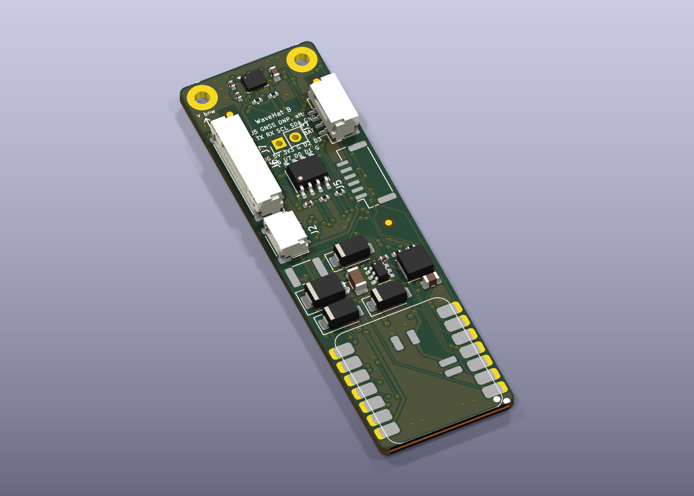

# WaveHat rev B KiCad project

KiCad 10 schematic and PCB for WaveHat **rev B**, started 30 Oct 2026 from the rev A project (`../kicad/`, which stays as ordered for the quality case and the test jig). Same generator pipeline; the rev B changes are in `wavehat_design.py` and the generators, listed below. Routed and DRC-clean on 30 Oct 2026; fab outputs in `fab/`. Not yet ordered, and not yet checked by eye in KiCad (DESIGN.md §13 still applies).

## What changed from rev A
| Change | Where |
|---|---|
| Board 21 × **69** mm: 8 mm added behind the sensor zone (holes, IMU, decoupling, pull-ups stay where they were; everything aft moved 8 mm), then 7 mm more at the J2/J6 band on 7 Nov 2026 for the IO header (everything from the fuse aft moved again) | `wavehat_design.py` `BOARD_L`, `SHIFT`, `SHIFT2` |
| **J6 IO header** (7 Nov 2026): 10-pin JST-GH on the left-hand edge forward of J2, 1 5V, 2 3V3, 3 GND, 4 D2, 5 D3, 6 D6, 7 D7, 8 D0, 9 D1, 10 GND, so leads for LEDs, a remote's UART, ESC telemetry or a mast sensor plug in instead of being soldered to the XIAO. Fitted (LCSC C2683602). J2 moved aft to y 30.2 | `wavehat_design.py` J6, J2 |
| **JP8, JP9, JP10** (7 Nov 2026): bridged solder jumpers in U3's 3V3, RXD and TXD. Cut all three (and open JP6) for a build with no CAN: U3 is then unpowered and off D0/D1, which are free on J6 | `wavehat_design.py` U3, C7, JP8–JP10 |
| **Battery option** (7 Nov 2026): XIAO footprint pads 15/16 (under the C3/S3 VBAT/GND pads) and 17/18 (under the C6's), paste on, so the module's own 1S charger is reachable; VBAT (0.4 mm) to **J7**, two 2.54 mm holes by J6 for a cell pigtail (DNP, pin 1 +) | `gen_schematic.py` `xiao_footprint()`, `wavehat_design.py` U4, J7 |
| **J5 GNSS port**: 6-pin JST-GH, Pixhawk GPS pinout (5V, TX, RX, SCL, SDA, GND), UART on XIAO D6/D7. On the right-hand edge aft of J3, opening flush with the edge like J2 and J3, so the plug slides in from outside the board (a connector facing along the board would have the IMU and C2 in the plug's path). J3 moved forward to sit beside the transceiver. DNP | `wavehat_design.py` J5, J3 |
| Buck parts that J5 displaced: C5 beside L1, R3/R4/C6 in a row between J5 and the inductor, L1 0.9 mm aft; FID3 to the free band behind the sensor zone (the XIAO covers the stern) | `wavehat_design.py` |
| **30 test pads** TP1–TP30 on the bottom, 1.0 mm, 2.54 mm grid, one per layer-crossing net plus GND, numbered on the silk; `reports/test-pads.md` lists them with their component-side partner | `wavehat_design.py` `TEST_PADS`, `gen_docs.py` |
| **Twin vias**: after routing, every non-GND via gets a second one 0.8–2.0 mm away, linked on both layers by a straight or L-shaped stub, wherever that clears the design rules. On the 7 Nov 2026 routing 43 of 102 signal and power vias got a twin; the other 59 are in spots too tight (the IMU fanout against the bow edge, under U3, the SD NAND lands, the J6 fanout) and stay single. `reports/vias.md` lists every via, twinned or not | `gen_pcb.py` `twin_vias()`, `via_report()` |
| **Pour cut** is added after routing, not before: the Specctra export turns any rule area into a full track keepout, which walled the IMU off on the first run | `gen_pcb.py` `pour_cut()` |
| **XIAO lands 3.45 × 2.0 mm**, grown outboard so 1.4 mm shows past the module; paste stays on the rev A 2.75 mm | `gen_schematic.py` `xiao_pad_rev_b()` |
| **3V3 in a 0.3 mm "Supply" net class** (rev A: 0.15 mm) | `gen_pcb.py` `RULES`, `D.SUPPLY_NETS` |
| **Pour cut** across the board at y 8.6: no copper fill crosses between the sensor zone and the rest | `gen_pcb.py` rule area "sensor zone: pour cut" |
| Silkscreen tidied: jumper labels no longer overlap, big parts' references on Fab | `gen_pcb.py` |
| Fab note: via plating **Horizontal Electroless Copper** | title block, `ORDER-JLCPCB-FULL.md` |

Not done (needs a wider board): mounting holes at the stern end. The XIAO spans the width to within 1.75 mm of each edge, so a second pair of M2 holes needs a 27 mm board; rev B keeps 21 mm and the enclosure's stern rail. The enclosure (`../../enclosure/`) needs `pcb_l` set to 69 for rev B.



## Files
| File | What |
|---|---|
| `wavehat.kicad_pro`, `wavehat.kicad_sch`, `wavehat.kicad_pcb` | The project. Open `wavehat.kicad_pro` in KiCad |
| `wavehat-schematic.pdf` | Schematic as PDF |
| **`fab/seeed/`** | **Ready for Seeed Fusion**: Gerbers named as Seeed asks, Seeed-format BOMs (with a XIAO C3 / C6 / S3 from Seeed's Open Parts Library, or without), two-sided pick-and-place, assembly drawings, one zip per option, and `ORDER.md` (copied from `ORDER-SEEED.md`) with what to pick on the order forms |
| **`fab/jlcpcb/no-storage/`, `fab/jlcpcb/full/`, `fab/jlcpcb/full-gnss/`** | JLCPCB assembly packs: top side only; the full two-sided build with J5 left off (hand-fit the GNSS port where wanted); and the full build **with J5 fitted** (LCSC C133065, Extended part). Each has the JLCPCB-format BOM with LCSC numbers, CPL (no XIAO), the same Gerbers and `ORDER.md` |
| `fab/wavehat-gerbers.zip` | Gerbers + drill (KiCad names), for PCBWay / JLCPCB |
| `fab/wavehat-bom.csv`, `fab/wavehat-cpl-top.csv`, `fab/wavehat-cpl-bottom.csv` | BOM and pick-and-place for each side (DNP excluded), mm from the board's lower-left corner. `fab/wavehat-cpl-top-with-dnp.csv` keeps J5, for the with-GNSS pack |
| `img/` | 3D renders, top, bottom and angled |
| `reports/erc.json`, `reports/drc.json` | The last ERC and DRC runs |
| `reports/test-pads.md` | The 30 bottom-side test pads: net, position, component-side partner (generated) |
| `reports/erc.json`, `reports/drc.json` | The last ERC and DRC runs |
| `reports/vias.md` | Every signal and power via with its twin, or the note that none fitted (generated) |
| `lib/wavehat.kicad_sym`, `lib/wavehat.pretty/` | Custom symbols (XIAO 14-pad, LSM6DSO, LMR51606, SD NAND) and footprints (XIAO 14-pad, NMEA 2000 pads, SD NAND LGA-8 8 × 6 mm) |
| `lib/seeed/` | Seeed's original XIAO library files the XIAO footprint is derived from (CC BY-SA 4.0) |
| `wavehat_design.py` | **The source.** Every part, footprint, connection, schematic position and board position |
| `gen_schematic.py`, `gen_pcb.py`, `gen_docs.py`, `gen_seeed.py`, `run_pipeline.sh` | Generators and the end-to-end script |
| `ORDER-SEEED.md` | Seeed Fusion order notes (source of `fab/seeed/ORDER.md`) |

## How it's built
Everything comes from `wavehat_design.py`:
1. `gen_schematic.py` writes the schematic. Every pin gets a short wire and a net label, so the drawing is a connectivity schematic rather than a hand-drawn one. It is checked with `kicad-cli sch erc`.
2. `gen_pcb.py place` builds the board in KiCad's own Python: outline, footprints linked to the schematic symbols by UUID (top, or bottom for the log storage), nets, keep-outs (nothing under the IMU; no vias near the XIAO's underside pads or the fiducials), silkscreen, the drill/place origin at the lower-left corner, and the design rules in the project file. It exports a Specctra DSN with the clearance raised to 0.17 mm for the router.
3. **Freerouting** routes every net, ground included.
4. `gen_pcb.py import` brings the routes back, widens the few pad-entry segments Freerouting thins below 0.15 mm (the 0.02 mm routing margin keeps their clearance), adds ground stitching vias where they clear everything, pours ground on both layers, fills, and removes any stitching via the pour left in an island.
5. `kicad-cli pcb drc --schematic-parity` checks it. If DRC finds an error or anything unconnected, steps 2–5 repeat from a freshly placed board with a different number of Freerouting passes (100, 150, 200, 80, 250, 120), up to six times. The script then exports Gerbers, drill, BOM, both CPLs, the PDF and renders; `gen_docs.py` regenerates `../netlist-revB.md`, `../bom-revB.csv` and `reports/test-pads.md`, and `gen_seeed.py` builds `fab/seeed/`.

To change the design, edit `wavehat_design.py` and run:

```bash
FREEROUTING=/path/to/freerouting-2.4.1.jar ./run_pipeline.sh
```

Hand edits in KiCad are fine too, but they are overwritten the next time the pipeline runs. Once you start polishing the layout by hand, stop regenerating the PCB, and keep `wavehat_design.py` for the schematic and docs only.

## Rules
| | |
|---|---|
| Signal track / clearance | 0.15 mm / 0.15 mm (6 mil, base capability at PCBWay, JLCPCB, Seeed Fusion) |
| Power track (VIN_RAW, VIN_FUSED, VIN, SW, 5V_BUCK, 5V_CAN, XIAO_5V) | 0.4 mm |
| Supply track (3V3) | 0.3 mm |
| Vias | 0.6 mm pad / 0.3 mm drill, tented, twinned on every signal and power crossing; order with electroless copper plating |
| Copper to edge | 0.3 mm |

## Last check (7 Nov 2026: rev B re-routed with J6, JP8-JP10 and the battery pads)
ERC 0 violations · DRC 0 errors, 0 unconnected · schematic parity 0 issues · 41 silkscreen warnings (silk over copper and the XIAO outline at the edge, cosmetic) · Freerouting 250 passes, clean on the fifth attempt · 102 signal/power vias, 43 twinned (the rest had no room: `reports/vias.md`), 20 stitching vias. Not yet re-quoted at JLCPCB after these changes.

## Tools used
- KiCad 10.0.7 (Homebrew cask `kicad`), using `kicad-cli` and the bundled Python `pcbnew` module.
- Freerouting 2.4.1 (https://github.com/freerouting/freerouting/releases/tag/v2.4.1), SHA-256 `251101c3eeac22d7e7dfcf6796603279e5d1000283eb82d8f093780f7afc6aa9`, re-downloaded 30 Oct 2026 to `../../../../tools/freerouting/freerouting-2.4.1.jar` (repo-relative `tools/freerouting/`) and the hash re-checked.
- OpenJDK (Homebrew `openjdk`) to run Freerouting.

## Sources and licences
- XIAO footprint: derived from Seeed-Studio/OPL_Kicad_Library `XIAO-ESP32-C3-SMD` (pads 15 and up removed so it fits the C3, C6 and S3). That library is **CC BY-SA 4.0**, so `lib/wavehat.pretty/XIAO_ESP32_14P_SMD.kicad_mod` is too. Pad map checked against Seeed's C3, C6 and S3 SMD footprints and symbols.
- LSM6DSO pin functions: ST application note AN5192. LMR51606 pins and the 5 V component values: TI datasheet SLUSEY1B.
- SD NAND pinout (SPI mode) and LGA-8 package: Zetta ZDSD01G/02G/04G datasheet (LCSC C2875853), MK MKDV4GCL (C7500178), CS-Creative CSNP4GCR01 and XTX XTSD04G datasheets; all share the pinout and 8 × 6 mm package.
- Other symbols and footprints: the KiCad standard libraries (CC BY-SA 4.0 with KiCad's exception for designs that use them).
- Circuit origin: the Takuma project's XIAO node (see `../DESIGN.md` §0).
