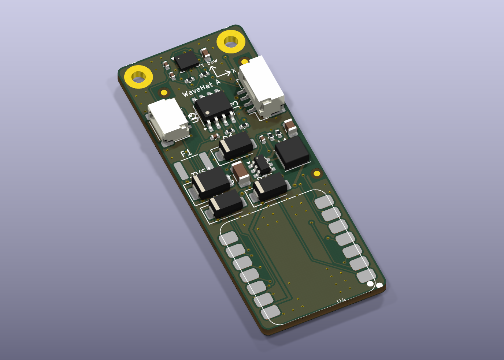

# WaveHat KiCad project

KiCad 10 schematic and PCB for WaveHat rev A, plus everything needed to order it.



## Files
| File | What |
|---|---|
| `wavehat.kicad_pro`, `wavehat.kicad_sch`, `wavehat.kicad_pcb` | The project. Open `wavehat.kicad_pro` in KiCad |
| `wavehat-schematic.pdf` | Schematic as PDF |
| **`fab/seeed/`** | **Ready for Seeed Fusion**: Gerbers named as Seeed asks, Seeed-format BOMs (with a XIAO C3 / C6 / S3 from Seeed's Open Parts Library, or without), two-sided pick-and-place, assembly drawings, one zip per option, and `ORDER.md` (copied from `ORDER-SEEED.md`) with what to pick on the order forms |
| **`fab/jlcpcb/no-storage/`, `fab/jlcpcb/full/`** | JLCPCB assembly quotes for the top-side-only build and the full two-sided build: JLCPCB-format BOM with LCSC part numbers, CPL (no XIAO), the same Gerbers, and `ORDER.md` (from `ORDER-JLCPCB.md` / `ORDER-JLCPCB-FULL.md`) |
| `fab/wavehat-gerbers.zip` | Gerbers + drill (KiCad names), for PCBWay / JLCPCB |
| `fab/wavehat-bom.csv`, `fab/wavehat-cpl-top.csv`, `fab/wavehat-cpl-bottom.csv` | BOM and pick-and-place for each side (DNP excluded), mm from the board's lower-left corner |
| `img/` | 3D renders, top, bottom and angled |
| `reports/erc.json`, `reports/drc.json` | The last ERC and DRC runs |
| `reports/vias.md` | Every via by net and position, for checking boards with open vias (rev A had some) |
| `lib/wavehat.kicad_sym`, `lib/wavehat.pretty/` | Custom symbols (XIAO 14-pad, LSM6DSO, LMR51606, SD NAND) and footprints (XIAO 14-pad, NMEA 2000 pads, SD NAND LGA-8 8 × 6 mm) |
| `lib/seeed/` | Seeed's original XIAO library files the XIAO footprint is derived from (CC BY-SA 4.0) |
| `wavehat_design.py` | **The source.** Every part, footprint, connection, schematic position and board position |
| `gen_schematic.py`, `gen_pcb.py`, `gen_docs.py`, `gen_seeed.py`, `run_pipeline.sh` | Generators and the end-to-end script |
| `ORDER-SEEED.md` | Seeed Fusion order notes (source of `fab/seeed/ORDER.md`) |

## How it's built
Everything comes from `wavehat_design.py`:
1. `gen_schematic.py` writes the schematic. Every pin gets a short wire and a net label, so the drawing is a connectivity schematic rather than a hand-drawn one. It is checked with `kicad-cli sch erc`.
2. `gen_pcb.py place` builds the board in KiCad's own Python: outline, footprints linked to the schematic symbols by UUID (top, or bottom for the log storage), nets, keep-outs (nothing under the IMU; no vias near the XIAO's underside pads or the fiducials), silkscreen, the drill/place origin at the lower-left corner, and the design rules in the project file. It exports a Specctra DSN with the clearance raised to 0.17 mm for the router.
3. **Freerouting** routes every net, ground included.
4. `gen_pcb.py import` brings the routes back, widens the few pad-entry segments Freerouting thins below 0.15 mm (the 0.02 mm routing margin keeps their clearance), adds ground stitching vias where they clear everything, pours ground on both layers, fills, and removes any stitching via the pour left in an island.
5. `kicad-cli pcb drc --schematic-parity` checks it. If DRC finds an error or anything unconnected, steps 2–5 repeat from a freshly placed board with a different number of Freerouting passes (100, 150, 200, 80, 250, 120), up to six times. The script then exports Gerbers, drill, BOM, both CPLs, the PDF and renders; `gen_docs.py` regenerates `../netlist.md` and `../bom.csv`, and `gen_seeed.py` builds `fab/seeed/`.

To change the design, edit `wavehat_design.py` and run:

```bash
FREEROUTING=/path/to/freerouting-2.4.1.jar ./run_pipeline.sh
```

Hand edits in KiCad are fine too, but they are overwritten the next time the pipeline runs. Once you start polishing the layout by hand, stop regenerating the PCB, and keep `wavehat_design.py` for the schematic and docs only.

## Rules
| | |
|---|---|
| Signal track / clearance | 0.15 mm / 0.15 mm (6 mil, base capability at PCBWay, JLCPCB, Seeed Fusion) |
| Power track (VIN_RAW, VIN_FUSED, VIN, SW, 5V_BUCK, 5V_CAN, XIAO_5V) | 0.4 mm |
| Vias | 0.6 mm pad / 0.3 mm drill, tented |
| Copper to edge | 0.3 mm |

## Last check (20 Oct 2026: log storage, 5–30 V input)
ERC 0 violations · DRC 0 errors, 0 unconnected · schematic parity 0 issues · 59 silkscreen warnings (cosmetic).

## Tools used
- KiCad 10.0.7 (Homebrew cask `kicad`), using `kicad-cli` and the bundled Python `pcbnew` module.
- Freerouting 2.4.1 (https://github.com/freerouting/freerouting/releases/tag/v2.4.1), SHA-256 `251101c3eeac22d7e7dfcf6796603279e5d1000283eb82d8f093780f7afc6aa9`, checked against GitHub's published asset digest. The newest release (2.5.0) was skipped as less than two weeks old.
- OpenJDK (Homebrew `openjdk`) to run Freerouting.

## Sources and licences
- XIAO footprint: derived from Seeed-Studio/OPL_Kicad_Library `XIAO-ESP32-C3-SMD` (pads 15 and up removed so it fits the C3, C6 and S3). That library is **CC BY-SA 4.0**, so `lib/wavehat.pretty/XIAO_ESP32_14P_SMD.kicad_mod` is too. Pad map checked against Seeed's C3, C6 and S3 SMD footprints and symbols.
- LSM6DSO pin functions: ST application note AN5192. LMR51606 pins and the 5 V component values: TI datasheet SLUSEY1B.
- SD NAND pinout (SPI mode) and LGA-8 package: Zetta ZDSD01G/02G/04G datasheet (LCSC C2875853), MK MKDV4GCL (C7500178), CS-Creative CSNP4GCR01 and XTX XTSD04G datasheets; all share the pinout and 8 × 6 mm package.
- Other symbols and footprints: the KiCad standard libraries (CC BY-SA 4.0 with KiCad's exception for designs that use them).
- Circuit origin: the Takuma project's XIAO node (see `../DESIGN.md` §0).
