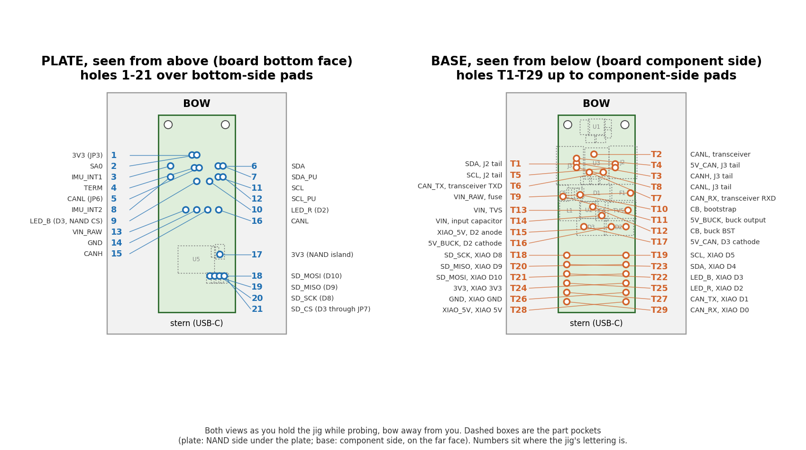

# WaveHat rev A via test checklist

One copy per board. Print it, or copy the block into `../kicad/reports/vias.md` under the board's
heading when done. Hole numbers are the ones on the jig; `legend.md` says what each hole is over.

Left: the plate as you look down on it (blue, 1-21). Right: the base as you look up at it from below
(orange, T1-T29). Labels are where the jig's own lettering is, with the net beside each. Regenerate with
`python3 gen_hole_map.py` after the hole lists change.

Board no. ______   Panel position ______   Date ______   Tester ______   Meter ______

Meter on **continuity / Ω**, lowest range. Probe tips: fine (needle or clip-on pin), so they reach
the pad through a 1.6 mm hole without touching the hole wall. Lead resistance (tips shorted): ______ Ω
(subtract from every reading; anything under 2 Ω after that counts as 0 Ω).

## A. Setup

- [ ] Board is bare: no XIAO fitted, no bodge wires yet. (A bodged board still gets tested; note the
      bodges under D and expect those readings to pass.)
- [ ] Board on the base **component side down**, bow end (mounting holes) at BOW. Rails, if still
      attached, overhang the base's long sides.
- [ ] Board lies flat and does not rock: J2, J3, J4, U3, the diodes and buck parts are in their pockets.
      Rocking = wrong way round or a part not in its pocket. Do not force it.
- [ ] Two M2 screws up through the mounting holes from below; plate dropped over them, lettering up,
      stern (USB-C) text at the stern.
- [ ] Looking through plate hole 17 you see a pad (C9), through hole 1 a jumper pad (JP3). If you see
      bare board, the plate is rotated.
- [ ] Jig raised on two blocks (or over the bench edge) for section C.
- [ ] Reference check: plate 14 (J4 GND) to base T26 (XIAO GND) = 0 Ω. Proves the probes reach the pads
      and the board is placed right. If this fails, fix the setup before going on.

## B. Plate to plate (both probes from above)

Hole numbers, then the pad under the hole. Positions are the vias in the path, mm from the board's
lower-left corner, component side up (the Gerber origin).

| ✓ | Net | A | B | Expect | Read | Fail means |
|---|---|---|---|---|---|---|
| [ ] | 3V3 | 17: C9 pad 1 | 1: JP3 pad 1 | 0 Ω | ______ | **C9.1 to JP3.1** open: one of the two 3V3 vias, (4.25, 7.50) island or (13.18, 43.44) JP3 side. Board 2's fault. D-8 tells which. |
| [ ] | CANL | 16: J4 pad 5 | 5: JP6 pad 2 | 0 Ω | ______ | **J4.5 to JP6.2** open: one of four CANL vias: (6.67, 30.02), (6.67, 32.36), (11.56, 41.11), (14.39, 39.50). C-3 covers the last two. |
| [ ] | SDA_PU | 7: JP1 pad 2 | 1: JP3 pad 1 | 4.7 kΩ | ______ | **JP1.2 to JP3.1** ∞: SDA_PU via (9.50, 46.49) or the JP3 3V3 via (13.18, 43.44) open. Other value: R1 wrong. |
| [ ] | SCL_PU | 12: JP2 pad 2 | 1: JP3 pad 1 | 4.7 kΩ | ______ | **JP2.2 to JP3.1** ∞: SCL_PU via (12.51, 48.22) or the JP3 3V3 via (13.18, 43.44) open. Other value: R2 wrong. |
| [ ] | TERM | 4: JP6 pad 1 | 15: J4 pad 4 | 120 Ω | ______ | **JP6.1 to J4.4** ∞: TERM via (13.91, 37.22) or a CANH via between J4 and R5, (7.61, 29.90), (9.11, 31.21), (12.97, 35.15), open. Other value: R5 wrong. |

## C. Base to base (both probes from below, up through the base)

| ✓ | Net | A | B | Expect | Read | Fail means |
|---|---|---|---|---|---|---|
| [ ] | CAN_TX | T27: U4 pad 2 (XIAO D1) | T6: U3 pad 1 (TXD) | 0 Ω | ______ | **U4.2 to U3.1** open: one of four CAN_TX vias: (3.39, 35.49), (4.27, 14.87), (8.64, 39.73), (15.17, 15.43). No CAN transmit. |
| [ ] | CAN_RX | T29: U4 pad 1 (XIAO D0) | T7: U3 pad 4 (RXD) | 0 Ω | ______ | **U4.1 to U3.4** open: one of two CAN_RX vias: (12.20, 35.02), (13.11, 25.53). No CAN receive. |
| [ ] | CANL | T8: J3 pad 2 | T2: U3 pad 6 | 0 Ω | ______ | **J3.2 to U3.6** open: one of the two CANL vias at the transceiver open: (11.56, 41.11), (14.39, 39.50). |
| [ ] | 5V_CAN | T17: D3 pad 2 | T4: J3 pad 4 | 0 Ω | ______ | **D3.2 to J3.4** open: one of two 5V_CAN vias: (14.61, 41.44), (14.66, 25.22). J3 has no 5 V. |
| [ ] | XIAO_5V | T28: U4 pad 14 (XIAO 5V) | T15: D2 pad 1 | 0 Ω | ______ | **U4.14 to D2.1** open: one of two XIAO_5V vias: (2.40, 21.91), (9.90, 21.87). XIAO unpowered from the buck. |
| [ ] | 5V_BUCK | T11: C5 pad 1 | T16: D2 pad 2 | 0 Ω | ______ | **C5.1 to D2.2** open: one of two 5V_BUCK vias: (7.83, 24.83), (15.78, 22.83). |
| [ ] | CB | T10: C6 pad 1 | T12: U2 pad 1 (BST) | 0 Ω | ______ | **C6.1 to U2.1** open: one of two CB vias: (11.46, 30.84), (14.90, 30.29). Buck will not start. |
| [ ] | VIN | T14: C4 pad 1 | T13: TVS1 pad 1 | 0 Ω | ______ | **C4.1 to TVS1.1** open: one of two VIN vias: (1.85, 26.17), (9.38, 25.23). TVS off the rail. |
| [ ] | SDA | T23: U4 pad 5 (XIAO D4) | T1: J2 pad 3 | 0 Ω | ______ | **U4.5 to J2.3** open: an SDA via between the XIAO and J2: (16.65, 22.65), (3.94, 26.09), (4.16, 38.71). (9.43, 52.08) at the IMU is not in this path. |
| [ ] | SCL | T19: U4 pad 6 (XIAO D5) | T5: J2 pad 4 | 0 Ω | ______ | **U4.6 to J2.4** open: an SCL via between the XIAO and J2: (17.75, 24.01), (5.33, 37.96). (11.00, 52.46) at the IMU is not in this path. |

## D. Plate to base (one probe each side)

| ✓ | Net | Plate | Base | Expect | Read | Fail means |
|---|---|---|---|---|---|---|
| [ ] | SD_SCK | 20: R10 pad 2 | T18: U4 pad 9 (XIAO D8) | 0 Ω | ______ | **R10.2 to U4.9** open: its single via (4.25, 13.73). Storage dead. |
| [ ] | SD_MISO | 19: R11 pad 2 | T20: U4 pad 10 (XIAO D9) | 0 Ω | ______ | **R11.2 to U4.10** open: its single via (4.52, 11.19). Storage dead. |
| [ ] | SD_MOSI | 18: R12 pad 2 | T21: U4 pad 11 (XIAO D10) | 0 Ω | ______ | **R12.2 to U4.11** open: its single via (4.77, 8.16). Storage dead. |
| [ ] | LED_B / SD CS | 9: TP2 pad 1 | T22: U4 pad 4 (XIAO D3) | 0 Ω | ______ | **TP2.1 to U4.4** open: its single via (16.20, 11.74). Board 2's second fault; NAND CS floats. |
| [ ] | LED_R | 10: TP1 pad 1 | T25: U4 pad 3 (XIAO D2) | 0 Ω | ______ | **TP1.1 to U4.3** open: its single via (16.59, 6.57). Red LED only. |
| [ ] | VIN_RAW | 13: J4 pad 2 | T9: F1 pad 1 | 0 Ω | ______ | **J4.2 to F1.1** open: its single via (1.16, 30.33). No input power from J4 at all. |
| [ ] | CANH | 15: J4 pad 4 | T3: J3 pad 3 | 0 Ω | ______ | **J4.4 to J3.3** open: one of three CANH vias: (7.61, 29.90), (9.11, 31.21), (12.97, 35.15). |
| [ ] | 3V3 island | 17: C9 pad 1 | T24: U4 pad 12 (XIAO 3V3) | 0 Ω | ______ | **C9.1 to U4.12** open: the island via (4.25, 7.50) on its own. Splits B-1. |
| [ ] | SDA | 6: JP1 pad 1 | T23: U4 pad 5 (XIAO D4) | 0 Ω | ______ | **JP1.1 to U4.5** open: an SDA via between the XIAO and JP1, from (16.65, 22.65), (3.94, 26.09), (4.16, 38.71), (9.43, 52.08). Compare with C-9. |
| [ ] | SCL | 11: JP2 pad 1 | T19: U4 pad 6 (XIAO D5) | 0 Ω | ______ | **JP2.1 to U4.6** open: an SCL via between the XIAO and JP2, from (17.75, 24.01), (5.33, 37.96), (11.00, 52.46). Compare with C-10. |
| [ ] | GND | 14: J4 pad 3 | T26: U4 pad 13 (XIAO GND) | 0 Ω | ______ | **J4.3 to U4.13** open: setup problem, not a via (done in A). |

## E. Not meterable (record from power-up later)

- [ ] SA0: IMU answers at 0x6B with JP3 at 3V3.
- [ ] IMU_INT1 / IMU_INT2: unused unless JP4 / JP5 are bridged; no check.

## F. Result

Readings taken: ____ / 26.   Fails: ____.   Failing nets: ______________________________________

Board disposition:
- [ ] **Pass**: all 26 at expected value. Mark the board "OK" on the rail with a marker.
- [ ] **Fail, bodgeable**: list the open vias by net and position (from `../kicad/reports/vias.md`),
      bodge with 30 AWG wire-wrap wire top pad to bottom pad, re-test the failing rows, then mark "B".
- [ ] **Fail, scrap**: a via under a part or a power via that cannot be reached. Keep it for the
      JLCPCB microsection.

Photos taken (for the quality case): [ ] both faces of each failed via under a loupe  [ ] meter showing
open circuit across one of them, with the probe positions visible.

Add the board number, fail count and failing nets to `../jlcpcb-quality-case.md` (the `[...]` blanks)
and to the per-board section of `../kicad/reports/vias.md`.

## Notes

- A reading that flickers between 0 and ∞ as you lean on the probe is a cracked barrel making
  contact under pressure: count it as a **fail**. Those fail again after the first thermal cycle.
- Readings of a few hundred Ω to a few kΩ on a 0 Ω row are leakage across the open via through
  other parts (board 2 read 2.27 V on the dead 3V3 island this way). Fail.
- A resistor row reading 0 Ω means the jumper is bridged or a short, not a good via.
- If B-1 fails and D-8 passes, the open via is the other 3V3 via (the one towards the XIAO), not
  the island via. If both fail, the island via is open and the other is unknown until it is bodged.
- Don't scrape mask to reach a via: every reading here lands on a pad.
