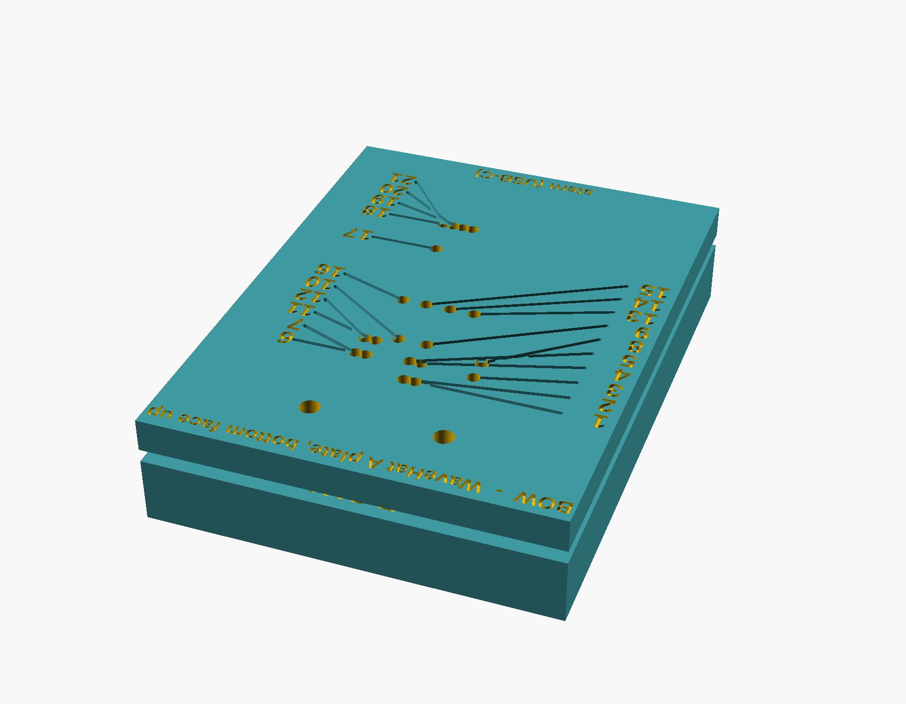

# WaveHat rev A test jig

A two-part 3D-printed jig for checking a WaveHat for open vias with a multimeter, in its JLCPCB rails
or snapped out. Both parts are flat against the board, with pockets only where parts are. The board
lies component side down on the **base**, its connectors and other parts sunk in pockets, held by two
M2 screws through its mounting holes; the **plate** lies on the bottom face with a numbered 1.6 mm hole
over each bottom-side probe pad. The base has a numbered 2 mm hole up through it at each component-side
landmark (the XIAO castellation lands, U3, the connector tails, the diodes and large passives), so the
second probe reaches up through the base: stand the jig across two blocks, or over the edge of the
bench, for the readings that need a probe underneath. `legend.md` lists every
reading: which two holes, the expected value, and which vias it proves.



| File | What |
|---|---|
| `wavehat_test_plate_base.stl` | Base: pockets, 29 numbered through-holes. In print orientation (pockets down, numbers up). |
| `wavehat_test_plate_plate.stl` | Plate: 21 numbered holes, NAND pockets underneath. Print numbers up. |
| `legend.md` | The readings in three tables, and what each hole is over (generated). |
| `hole_map.png` / `.svg` | Labelled picture of both faces: plate holes 1-21 and base holes T1-T29 with their nets (`gen_hole_map.py` draws it from the point lists). |
| `CHECKLIST.md` | One-per-board test form with the hole map at the top: setup checks, the 26 readings with tick boxes and a column for the measured value, what each fail means, disposition and what to record for the quality case. |
| `dual/` | Two-colour versions for a dual-extruder printer: `*_body.stl` (the part with the lettering cut out) and `*_text.stl` (the lettering as a 0.5 mm solid that fills the cut), for the base and the plate, same coordinates and print orientation. Load each pair into the slicer as one object with two parts (Bambu Studio asks when you drop both files together) and give the text part the second extruder. `render_dual.png` shows the result. |
| `wavehat_test_plate.scad` | OpenSCAD source; sizes are variables at the top. |
| `test_plate_points.scad` | Hole and pocket lists, generated from the KiCad layout. |
| `gen_test_plate.py` | Reads `../kicad/wavehat.kicad_pcb` with KiCad's Python, writes the two generated files. |

**Print:** 0.2 mm layers, 3 perimeters, any PLA or PETG, no supports; both files are already in print
orientation. Lettering is recessed 0.5 mm; rub a marker over it and wipe if it is hard to read, or
print the two-colour pair from `dual/`. The base's text part also carries the BOW on the pocket face,
which prints as a first-layer colour change.

**Hardware:** 2 × M2 × 12 or 14 screws (they thread into the base from below, pass through the board
and locate the plate).

**Use**

1. The board can stay in its JLCPCB rails: the panel lies flat across the base and the rails overhang
   its sides. A snapped-out board works the same way.
2. Lay it on component side **down**, bow end (mounting holes) at BOW. J2, J3 and the other parts
   sit in their pockets and the board lies flat; if it rocks, it is the wrong way round. Run the two
   screws up from below through the mounting holes, drop the plate over them.
3. Work through `CHECKLIST.md` (one copy per board; `legend.md` has the detail): plate-to-plate readings first (both probes from above), then base-to-base
   (both probes from below, up through the base's holes, with the jig raised on blocks), then plate-to-base
   (one probe each side). Every reading is 0 Ω or the stated resistor; anything else is an open via on
   that net, and the legend says which vias are in the path. Nothing needs its solder mask scraped.
4. Note the board number and the failing readings; those go into `../jlcpcb-quality-case.md`.
5. The jig is for bare boards: a fitted XIAO has no pocket. SA0 and the IMU interrupt lines cannot be
   metered (they end under the IMU); the IMU answering at 0x6B covers SA0.

**Regenerating after a layout change**

```bash
/Applications/KiCad/KiCad.app/Contents/Frameworks/Python.framework/Versions/3.9/bin/python3 gen_test_plate.py
```

then

```bash
openscad -D 'part="base"' -o wavehat_test_plate_base.stl wavehat_test_plate.scad
```

and the same with `plate`. The probe lists (`BOTTOM`, `TOP`, `READINGS`) are at the top of the
generator; the pockets follow the footprints' bounding boxes with the part heights in `HEIGHTS`, so a
new part needs a height there.

Rev B puts a numbered test pad on every layer crossing (`../DESIGN.md` §11), after which the plate
becomes a pogo-pin fixture with the same hole list.
